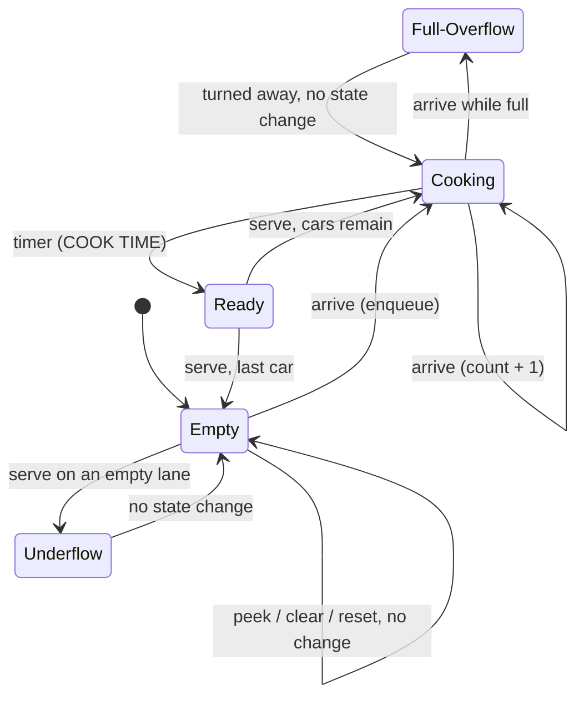

# Simulation 2: The Fast-Food Drive-Thru & Kitchen (Queue — FIFO)

A multi-stage drive-thru. Cars arrive at the entry gate (enqueue at the REAR), wait bumper-to-bumper in a single lane while the kitchen cooks the order at the front, and leave from the pickup window (dequeue at the FRONT). The lane is drawn live with FRONT/HEAD and REAR/TAIL pointer markers.

---

## 1. Why a Queue?

"First-In, First-Out" is fairness in a waiting line, which everyone already understands. **The car that arrived first eats first.**

The two ends do different jobs: **enqueue only at the rear** (entry gate), **dequeue only at the front** (pickup window). The stack used one end; the queue uses both.

Contrast with Simulation 1: a stack would serve the car that just pulled in, which is clearly unfair.

---

## 2. Learning Objectives

After the demo, students should be able to:

1. Define a queue and its operations: `enqueue`, `dequeue`, `peek`, `isEmpty`, `isFull`, `size`.
2. Explain FIFO with the drive-thru, and why it is fair.
3. Name which end each operation uses (rear = enqueue, front = dequeue/peek).
4. Explain why a standard queue forbids accessing or removing a middle element.
5. Recognize **queue overflow** (car turned away at a full lane) and **queue underflow** (serving an empty lane).
6. Compare the linear (STRAIGHT) queue, where dequeue shifts n−1 cars (O(n)), with the circular (RING) queue, where front/rear wrap with modulo (O(1)).
7. Trace `front`, `rear`, and `count` by hand, including wrap-around: `(i + 1) % capacity`.
8. State the time complexity of every operation.
9. Read an array-based queue in **C** and match each line to the animation.

---

## 3. Tech Stack & Deployment

### 3.1 Stack, Rules & Vercel Config

The stack, the minimal-internet rules, the page-weight budget (≤ 30 KB gzipped of code per page, fonts excluded), and the Vercel configuration are the same as STACK.md §3 / §3.1 / §3.3. Only the queue deltas are listed in this section.

### 3.2 Site Layout

The tree shows the repo **after** the build; new and moved files are marked:

```
/
├── index.html             # landing: QUEUE card becomes a live link (§3.3)
├── sw.js                  # precache list + CACHE_VERSION bump (§3.3)
├── assets/
│   ├── theme.css
│   ├── sim.css            # NEW (moved from stack/style.css): site header, settings dropdown, tour, code panel, tabs, log, toast
│   ├── code-panel.js      # MOVED from stack/, now configurable (§3.3)
│   ├── tour.js            # MOVED from stack/, now configurable (§3.3)
│   ├── landing.css, sw-register.js, favicon.svg, fonts/
├── stack/                 # unchanged behavior; loads ../assets/sim.css, ../assets/code-panel.js, ../assets/tour.js
├── queue/
│   ├── index.html         # lane, kitchen, controls, C code panel, operation log
│   ├── style.css          # queue-only layout + lane/car/kitchen animations
│   ├── queue.js           # Queue class (the data structure — no DOM code)
│   ├── drive-thru.js      # DriveThru model: mirrors C §5, emits C traces (no DOM)
│   ├── app.js             # DOM: rendering, animations, kitchen timer, callouts, log, tabs, settings, Tour.init
│   └── c-source.js        # C_SOURCE for drive_thru.c (§7.5)
└── scripts/
    ├── check-c.mjs        # now checks both programs (§3.3)
    ├── expected-stack.txt # RENAMED from expected-demo.txt
    └── expected-queue.txt # NEW: = §8 expected output
```

- `queue.js` contains no DOM code, so it can go on a slide by itself.
- Canonical URL is `/queue/` (trailing slash), the same rule as STACK.md §3.2.

### 3.3 Changes to Shared Files

Build-time table (the doc lists them, nothing is done now):

| File | Change |
|---|---|
| `assets/code-panel.js` | Moved from `stack/code-panel.js`. `CodePanel.mount(rootEl, { source, anchors, title, filename, sections, types, formatWatch })`: `title` replaces the hard-coded `UNDO_REDO.C` header, `filename` replaces `'undo_redo.c'` for download, `sections` replaces the hard-coded section labels, and `types` (e.g. `['Car','Queue']`) is appended to the keyword set. `TOKEN_RE` is built from the base keywords + `types` (the keyword set is no longer hard-coded). `formatWatch(w) → string` replaces the stack-specific `setWatch` text. The return value is unchanged: `{ ok, play, skip, setWatch }`. |
| `assets/tour.js` | Moved from `stack/tour.js`. It no longer auto-initializes. It exports `globalThis.Tour = { init({ steps, seenKey }) }`. Each page's main script calls `Tour.init` once its DOM is ready. Stack keeps `seenKey: 'dsa-sims-tour-seen'` (returning users are not re-toured). Queue uses `'dsa-sims-queue-tour-seen'`. |
| `assets/sim.css` | The `.site-header`, `.settings*`, `.tour*`, `.tabs`, `.code-panel*`, `.code*`, log, and toast rules move out of `stack/style.css`. Both pages link it after `theme.css`. |
| `stack/index.html`, `stack/editor.js` | Load the shared files. `editor.js` passes `title: 'UNDO_REDO.C'`, `filename: 'undo_redo.c'`, `sections: ['DATA','STACK OPS','UNDO/REDO','HELPERS','MAIN']`, `types: ['Action','Stack']`, the existing watch format, and the existing 13 tour steps. The stack page must look and behave identically. |
| `scripts/check-c.mjs` | Table of programs: `stack` → `stack/c-source.js`, `scripts/expected-stack.txt`, binary `undo_redo`; `queue` → `queue/c-source.js`, `scripts/expected-queue.txt`, binary `drive_thru`. `node scripts/check-c.mjs` checks both; `node scripts/check-c.mjs queue` checks one. Prints `check-c: <name> OK (…)` per program and exits non-zero on the first failure. Same compiler flags as today. |
| `index.html` (landing) | QUEUE card turns into an `<a class="card sim-card" href="queue/index.html" style="--tilt:3deg">`: drop `is-soon`, `aria-disabled`, and the `COMING SOON` stamp; subtitle `DRIVE-THRU & KITCHEN`; meta `FIRST IN, FIRST OUT`; add a lime `OPEN →` CTA. Keep the existing queue SVG art. The meta description mentions both simulations. |
| `sw.js` | Add `/queue/`, every `queue/*` file, `assets/sim.css`, `assets/code-panel.js`, `assets/tour.js`. Remove the `stack/code-panel.js` and `stack/tour.js` entries. Bump `CACHE_VERSION` on every deploy (currently `'v9'`). |
| `STACK.md` | Update the §3.2 tree, the §3.4/§7.6 script and expected-file names, the §3.5 flow and QUEUE card row, and the §11 landing item, so they match the new layout. |

### 3.4 Local Preview

- Quick look: double-click `queue/index.html`; everything except the service worker runs.
- Real preview (service worker included): `npx serve .`, then open `http://localhost:3000/queue/`.
- Model and C checks: `node scripts/check-c.mjs queue`.

---

## 4. The Data Structure

### 4.1 `Queue` class (`queue.js`)

The queue is array-backed with a **fixed capacity**, mirroring the C version's `Car items[MAX_CAP]` (§7.5). Private fields `#items`, `#front`, `#rear`, `#count`, `#capacity`. It never throws, except the constructor throws `RangeError` for a non-integer or < 1 capacity (same as `Stack`). Exposed as `globalThis.Queue`.

| Method | C equivalent | Behavior | Time |
|---|---|---|---|
| `constructor(capacity)` | `init(&q, capacity)` | `front = 0`, `rear = -1`, `count = 0` | O(1) |
| `enqueueLine(item)` | `bool enqueueLine(Queue *q, Car c)` | Full → `false` (overflow). Else `rear++`, store, `count++`, `true` | O(1) |
| `dequeueLine()` | `bool dequeueLine(Queue *q, Car *out)` | Empty → `null` (underflow). Else take `items[front]`, then an explicit `for` loop copies `items[i] = items[i+1]` for `i < count-1` (no `Array.prototype.shift`), `rear--`, `count--`, return the item | O(n) |
| `enqueueRing(item)` | `bool enqueueRing(…)` | Full → `false`. Else `rear = (rear + 1) % capacity`, store, `count++`, `true` | O(1) |
| `dequeueRing()` | `bool dequeueRing(…)` | Empty → `null`. Else take `items[front]`, `front = (front + 1) % capacity`, `count--`, return it | O(1) |
| `peek()` | `const Car *peek(const Queue *q)` | Front item without removing; `null` when empty | O(1) |
| `isEmpty()` / `isFull()` / `size()` | same | `count === 0` / `count === capacity` / `count` | O(1) |
| `front` / `rear` / `capacity` (getters) | `q->front` / `q->rear` / `q->capacity` | raw indices for pointer markers | O(1) |
| `clear()` | `clear(q)` | `front = 0`, `rear = -1`, `count = 0` | O(1) |
| `toArray()` | loop `items[(front + i) % capacity]` | Copy front → rear, used only for rendering | O(n) |

Rules:

- There is **no `getAt(i)` / no middle access**. This is deliberate (§9).
- One instance must only ever use one lane's pair (`…Line` or `…Ring`). `DriveThru` guarantees this by creating a fresh `Queue` on every mode switch. Mixing the pairs breaks the STRAIGHT invariant `front === 0`.

### 4.2 What gets enqueued: a `Car`

```js
{
  ticket: 4,              // painted on the roof; unique per arrival attempt (C: c.ticket)
  order:  "SUNDAE",       // selected menu items joined with " + " (C: c.order)
}
```

The car's color is UI-only: `(ticket - 1) % 4` → pink, lime, note-yellow, white (tokens `--pink`, `--lime`, `--note`, `--white`).

### 4.3 Menu and Order Rules

Five menu chips in this fixed order: `BURGER`, `FRIES`, `SODA`, `NUGGETS`, `SUNDAE`. Multi-select, 1–3 chips. The order string joins the selected chips **in menu order** with `" + "` (e.g. `FRIES + SODA`). The longest possible order is 25 characters, which is under C `MAX_ORDER` 32. JS still truncates to 31 characters to mirror `snprintf`. BURGER is selected on page load. The selection persists after ARRIVE. Selecting a 4th chip is refused (the chip shakes). Deselecting the last chip leaves 0 selected, which disables ARRIVE.

---

## 5. The Algorithm

Pseudocode blocks, matching the C exactly.

### 5.1 Arrive (enqueue)

```
arrive(order):
    c.ticket = nextTicket++
    c.order  = order (truncated to 31 chars)
    ok = ringMode ? enqueueRing(&lane, c) : enqueueLine(&lane, c)
    if not ok:
        turnedAway++          # OVERFLOW: car turned away, ticket still used up
    return ok
```

On `false` the car is turned away and its ticket number is still used up (`turnedAway++`).

### 5.2 Serve (dequeue)

```
serve(out):
    return ringMode ? dequeueRing(&lane, out) : dequeueLine(&lane, out)
```

`false` / `null` is **underflow**: no state change. The contrast is the whole point:

- In **STRAIGHT**, the FRONT pointer never leaves slot `[0]`: the cars roll forward (the `for` loop, n−1 copies) and REAR steps back one.
- In **RING**, the cars stay parked and FRONT advances one slot clockwise.

Both satisfy the concept's "front advances, the line moves up one spot": physically the line always moves up, and in memory only one of the two moves data.

### 5.3 Peek and Clear

```
peek()  -> front car (null when empty), size unchanged
clear() -> front = 0, rear = -1, count = 0   # O(1)
```

`peek()` returns the front car (null when empty) and does not change the size. `clear()` resets the three indices in O(1). The kitchen throws away all orders.

### 5.4 Lane Reset

Changing LANE (STRAIGHT/RING) or LANE SIZE runs `init(&lane, capacity)` with the new `ringMode`. `nextTicket` and `turnedAway` are **not** reset (C `init` doesn't touch them; a page reload does). Callout: "Lane reset: RING lane, 5 spots."

### 5.5 Kitchen Cook Cycle (UI only, not in C)

States `IDLE` → `COOKING(ticket)` → `READY(ticket)`. Whenever the front car changes (enqueue into an empty lane, a successful dequeue that leaves cars, a reset or clear), the kitchen calls `queue.peek()`. `null` → IDLE. Otherwise it starts COOKING that ticket for `COOK TIME` ms (0 → READY immediately). The timer starts when the model changes, not after the animation. Clear, reset, and a successful dequeue cancel the running timer. Only one order cooks at a time, always the front one.

### 5.6 State Machine



### 5.7 Invariants

- `0 ≤ count ≤ capacity`.
- STRAIGHT: `front === 0` and `rear === count - 1` at all times.
- RING: `rear === (front + count - 1 + capacity) % capacity` whenever `count > 0`.
- Full is `count === capacity`. In RING it is never `rear === capacity - 1`, which is why `count` exists: when the ring is full and when it is empty, `front` sits right after `rear` (`front === (rear + 1) % capacity`), so the indices alone cannot tell the two apart.
- Dequeue order equals enqueue order of the successful arrivals.
- Only `front` (dequeue/peek) and `rear` (enqueue) are touched.

---

## 6. Controls

### 6.1 Main Controls

| Control | What it does | Disabled when |
|---|---|---|
| Menu chips | Build the order (§4.3) | never |
| **ARRIVE** (lime) | §5.1 | no chip selected. Stays **enabled when the lane is full**, so overflow can be shown |
| **SERVE** | §5.2 | the front order is COOKING. Stays **enabled when the lane is empty**, so underflow can be shown |
| **PEEK** (lane header) | §5.3 | never (peek on empty is a lesson) |
| **CLEAR** (lane header) | §5.3 | lane empty |
| **LANE: STRAIGHT / RING** segmented toggle (lane header) | §5.4 | never. The active mode is `aria-pressed="true"` |
| Click/tap a car | Front car = PEEK. Any other car = cut-in attempt (§7.3) | — |

### 6.2 SETTINGS

SETTINGS is the same component and placement as the stack. It holds `LANE SIZE` 3/4/5/6 (default **5**, resets the lane), `COOK TIME` OFF / 1.5 S / 3 S (default **1.5 S**, takes effect from the next order that starts cooking), and `CALLOUTS` on/off. There is no "unlimited" lane: C `Car items[MAX_CAP]`, `MAX_CAP` = 6.

### 6.3 Keyboard

`A` ARRIVE, `S` SERVE, `P` PEEK. Ignored when Ctrl/Alt/Meta is held, when focus is in a `select`/`input`, or while the tour is open. Pressing `S` while COOKING shows the callout "Order #N is still cooking. SERVE unlocks when it's READY." and makes no model call.

---

## 7. Core Mechanics & UI

### 7.1 Visual Display

Desktop (≥ 1200px): header (← HOME, wordmark, ⚙, TIPS; eyebrow `SIMULATION 02 · QUEUE (FIFO)`; h2 `DRIVE-THRU & KITCHEN`). Left column: the lane panel at full width; under it a row with the order panel (chips, ARRIVE, SERVE, bubble) and the kitchen panel side by side. Right column: the sticky C panel. Full-width operation log at the bottom.

```
│ DRIVE-THRU LANE   [STRAIGHT|ring]   3/5   [PEEK] [CLEAR]                 │
│ ┌PICKUP┐ [0]      [1]      [2]      [3]      [4]       ┌GATE┐ TURNED AWAY 0│
│ │ ▣ ◀  │ ◀▇#1▇   ◀▇#2▇   ◀▇#3▇   ┌ ─ ─ ┐  ┌ ─ ─ ┐    │ ╪  │             │
│ └──────┘ BURGER   FRIES+…  NUGGETS └ ─ ─ ┘  └ ─ ─ ┘    └────┘             │
│          ▲FRONT·HEAD       ▲REAR·TAIL                                       │
│          front = 0 · rear = 2 · count = 3                                   │
```

RING mockup (smaller):

```
│ DRIVE-THRU LANE   [straight|RING]   3/5   [PEEK] [CLEAR]                 │
│              [2] #10                                                      │
│        [1] #9      ╭───────────────╮        ┌GATE┐ TURNED AWAY 0        │
│   [0] #8 ─────────▶│ front = 2     │◀────── │ ╪  │                       │
│        ▲FRONT·HEAD │ rear = 2      │   ▲REAR·TAIL                          │
│                    │ (4 + 1) % 5 = 0│                                     │
│        [4] ┌ ─ ─ ┐ └───────────────┘   [3] ┌ ─ ─ ┐                        │
```

| Component | Behavior |
|---|---|
| **Lane (STRAIGHT)** | A black asphalt strip with dashed white lane marks. The pickup window booth is on the **left**, the entry gate (with a barrier arm) on the **right**. Cars face left. Slots `[0]…[capacity-1]` run left → right, so the reading order matches the C array. Unused slots are dashed empty outlines. |
| **Lane (RING)** | Slots sit on a circle with `[0]` at 12 o'clock, running clockwise, and cars drive clockwise. The ring center shows `front = f · rear = r` and the last modulo step (e.g. `rear = (4 + 1) % 5 = 0`). |
| **Pointer markers** | FRONT/HEAD is a lime tag and REAR/TAIL a pink tag, each with an arrow to its slot (below the slot when STRAIGHT, outside the ring when RING). With one car, both tags stack on that slot. When `count === 0`, both tags are drawn ghosted (dashed). FRONT sits at slot `front`, and REAR at slot `rear`; if `rear === -1`, REAR sits just left of slot [0] (STRAIGHT) or just outside slot [0] (RING), labeled `rear = -1`. |
| **Cars** | An inline-SVG top-down car, `--border`, hard shadow, with the roof label `#n` and the order text under the car (both visible on desktop/tablet; phones show only `#n`, §7.6). A FULL lane gets the red `FULL` stamp. The gate shows a `TURNED AWAY n` counter, red when n > 0. |
| **Kitchen panel** | A white card with a black header strip `KITCHEN`. `NOW COOKING #n ORDER` shows a progress bar (lime fill on black) that fills over COOK TIME, then a lime `READY ✓` pill. The pickup booth's light goes from red to green. A `TICKET RAIL` lists cream paper tickets front → rear (oldest on the left) from `toArray()`, and the front ticket is outlined. IDLE shows `NO ORDERS`. |
| **Callout bubble, operation log, C code panel, SETTINGS, TIPS** | Same components as STACK.md §7.1, with queue content. |

Log line formats (newest first; overflow/underflow/cut-in lines red):

```
#1 ARRIVE  enqueueLine(#1 BURGER) → true  front 0 · rear 0 · size 1/5
#8 ARRIVE  enqueueLine(#7 NUGGETS) → false  OVERFLOW · turned away 1
#6 SERVE  dequeueLine() → #1 BURGER  2 cars rolled forward  front 0 · rear 1 · size 2/5
#13 SERVE  dequeueRing() → #8 BURGER  front 1 · rear 2 · size 2/5
#11 SERVE  dequeueLine() → false  UNDERFLOW
#5 PEEK  peek() → #1 BURGER  size 3/5
#9 CUT IN  #4 refused: no getAt(i) in a queue
#12 RESET  init(&lane, 5)  RING
#14 CLEAR  clear(&lane)  size 0/5
```

### 7.2 Step-by-Step Flow (Animations)

Same rules as STACK.md §7.2: the model updates immediately, animations only replay, a new action skips pending animations to their end, CSS transforms only, instant under `prefers-reduced-motion`.

| Event | What the audience sees |
|---|---|
| Enqueue (STRAIGHT) | The gate arm lifts and the car drives in from the right edge, rolling left to slot `rear` (300 ms + 40 ms per slot crossed, max 500 ms). REAR tag slides to it. The size ticks up. The ticket appears on the rail. |
| Enqueue (RING) | The car drives in from outside the ring to slot `rear` (≤ 400 ms). REAR tag moves clockwise. On wrap (`[cap-1]` → `[0]`), the tag crosses 12 o'clock with a `WRAP` badge and the center formula flashes. |
| Dequeue (STRAIGHT) | The front car pulls out past the pickup window and off the left edge (350 ms). Then every remaining car rolls forward one slot, left to right, 60 ms apart (250 ms each). REAR tag steps back. The FRONT tag stays on [0] and pulses once. The C `for` line shows `×n`. |
| Dequeue (RING) | The front car exits outward from its slot (350 ms). **No other car moves.** FRONT tag advances clockwise (with `WRAP` on [cap-1] → [0]). |
| Overflow | The car pulls up to the closed gate. The lane shakes under a red `QUEUE OVERFLOW` stamp. The car shows a `!` and U-turns off to the right. `TURNED AWAY` increments. |
| Underflow | The pickup booth wobbles. Nothing moves. |
| Peek | The front car glows lime and bobs for 1.5 s, its rail ticket is outlined, and the size counter pulses (unchanged). |
| Clear | All cars fade out front-first, 80 ms apart. The rail empties. The kitchen goes IDLE. |
| Cut-in attempt | The clicked car shakes. A red `NO CUTTING` sign pops over it for 1.2 s. |
| Mode/size reset | The lane cross-fades to the new shape, empty. |

### 7.3 Callouts

Same rules as STACK.md §7.3: 4 s display, CALLOUTS off switch. Enqueue/dequeue callouts show only the first 3 times; all others show every time. Exact text:

| Trigger | Callout |
|---|---|
| Enqueue | "`enqueue()`: car #N joins at the REAR. rear = R, size S/C." |
| Rear wrap (RING) | "**Wrap-around!** rear = (R₀ + 1) % C = 0. Slot [0] was free, so the ring reuses it. No car moved." |
| Dequeue STRAIGHT | "`dequeue()` served #N from the FRONT: First In, First Out. The other K cars each rolled forward one slot: K copies, O(n)." |
| Dequeue RING | "`dequeue()` served #N. FRONT moved to slot F; no car moved. O(1)." |
| Front wrap (RING) | "**Wrap-around!** front = (F₀ + 1) % C = 0." |
| Overflow | "**Queue Overflow!** The lane is full (C/C). `enqueue()` returned `false`, so car #N was turned away. Turned away: T." |
| Underflow | "**Queue Underflow!** `dequeue()` on an empty lane returned `false`. Nobody to serve." |
| Peek | "**`peek()` → #N ORDER.** You read the FRONT order without removing the car. Size is still S. The kitchen uses this to know what to cook." |
| Peek on empty | "`peek()` → `NULL`: the lane is empty." |
| Cut-in | "**No cutting the line!** A queue has no `getAt(i)`: only the FRONT can leave and only the REAR can join. Serving #N now would skip #F, breaking First In, First Out." (#F = current front ticket) |
| Still cooking (`S` key) | §6.3 text |
| Clear | "`clear(&lane)` reset front = 0, rear = -1, count = 0: K cars gone at once. The kitchen threw away their orders." |
| Reset | "Lane reset: MODE lane, C spots." |
| Full RING with front ≠ 0 | appended to the Overflow callout when RING: "Full means count == capacity, not rear == C-1." |

### 7.4 Visual Theme

The same tokens and components as STACK.md §7.5. Queue page mapping: cream page; black lane with white dashes; car colors per §4.2; FRONT tag lime, REAR tag pink; kitchen card white; tickets cream; READY pill lime; FULL / QUEUE OVERFLOW / NO CUTTING are `.stamp` red.

Accessibility: the lane and kitchen regions are `aria-live="polite"` and announce arrive/serve/peek/overflow/underflow/ready. Cars are `<button>`s labeled e.g. "Car #3, NUGGETS, slot 2".

### 7.5 C Code Panel

**Why C:** the fixed `Car items[MAX_CAP]` and explicit `front`/`rear`/`count` make overflow, wrap-around, and shifting visible.

**Single source:** `queue/c-source.js` sets `C_SOURCE` with `String.raw`. Standard C99, standard headers only, 170 lines in six sections: Data · Queue ops · Straight lane · Ring lane · Drive-thru · `main()` demo.

**Verification claim:** "Compiles with zero warnings under `gcc -std=c99 -Wall -Wextra -Wpedantic -Werror -O2`; `main()` replays the §8 script and its output matches §8 exactly." This claim is true only after the Verification step below passes.

<details>
<summary>Full <code>drive_thru.c</code> (exactly what the panel shows)</summary>

```c
/* drive_thru.c - Drive-thru lane as an array-based queue (FIFO): straight and ring */
#include <stdio.h>
#include <stdbool.h>

#define MAX_ORDER 32   /* order text, e.g. "FRIES + SODA"      */
#define MAX_CAP    6   /* largest LANE SIZE option             */

/* ---------- 1. The data ---------- */
typedef struct {
    int  ticket;             /* car number painted on the roof   */
    char order[MAX_ORDER];   /* what the driver ordered          */
} Car;

typedef struct {
    Car items[MAX_CAP];
    int front;               /* index of the first car (pickup)  */
    int rear;                /* index of the last car (entry)    */
    int count;               /* cars in the lane                 */
    int capacity;            /* chosen LANE SIZE: 3, 4, 5, 6     */
} Queue;

/* ---------- 2. Queue operations shared by both lanes ---------- */
void init(Queue *q, int capacity) {
    q->front = 0;
    q->rear = -1;
    q->count = 0;
    q->capacity = capacity;
}

bool isEmpty(const Queue *q) { return q->count == 0; }
bool isFull(const Queue *q)  { return q->count == q->capacity; }
int  size(const Queue *q)    { return q->count; }
void clear(Queue *q)         { q->front = 0; q->rear = -1; q->count = 0; }

const Car *peek(const Queue *q) {
    if (isEmpty(q)) {
        return NULL;
    }
    return &q->items[q->front];       /* look at the front, don't remove */
}
/* No getAt(i): a queue only touches its FRONT and its REAR. */

/* ---------- 3. Straight lane: linear queue, cars roll forward ---------- */
bool enqueueLine(Queue *q, Car c) {
    if (isFull(q)) {
        return false;                 /* QUEUE OVERFLOW: lane full    */
    }
    q->rear++;
    q->items[q->rear] = c;
    q->count++;
    return true;
}

bool dequeueLine(Queue *q, Car *out) {
    int i;
    if (isEmpty(q)) {
        return false;                 /* QUEUE UNDERFLOW: lane empty  */
    }
    *out = q->items[q->front];        /* front is always slot 0       */
    for (i = 0; i < q->count - 1; i++) {
        q->items[i] = q->items[i + 1];    /* every car rolls forward: O(n) */
    }
    q->rear--;
    q->count--;
    return true;
}

/* ---------- 4. Ring lane: circular queue, pointers wrap ---------- */
bool enqueueRing(Queue *q, Car c) {
    if (isFull(q)) {
        return false;                 /* QUEUE OVERFLOW: lane full    */
    }
    q->rear = (q->rear + 1) % q->capacity;    /* wraps to reuse slot 0 */
    q->items[q->rear] = c;
    q->count++;
    return true;
}

bool dequeueRing(Queue *q, Car *out) {
    if (isEmpty(q)) {
        return false;                 /* QUEUE UNDERFLOW: lane empty  */
    }
    *out = q->items[q->front];
    q->front = (q->front + 1) % q->capacity;  /* no shifting: O(1)     */
    q->count--;
    return true;
}

/* ---------- 5. The drive-thru ---------- */
Queue lane;
bool ringMode = false;       /* LANE toggle: false = STRAIGHT, true = RING */
int nextTicket = 1;
int turnedAway = 0;

bool arrive(const char *order) {
    Car c;
    bool ok;
    c.ticket = nextTicket++;
    snprintf(c.order, MAX_ORDER, "%s", order);
    if (ringMode) {
        ok = enqueueRing(&lane, c);
    } else {
        ok = enqueueLine(&lane, c);
    }
    if (!ok) {
        turnedAway++;                 /* lane full: the car drives off */
    }
    return ok;
}

bool serve(Car *out) {
    if (ringMode) {
        return dequeueRing(&lane, out);
    }
    return dequeueLine(&lane, out);
}

/* ---------- 6. Demo: the classroom script ---------- */
void show(const char *step) {
    int i;
    printf("%s\n  lane  [", step);
    for (i = 0; i < lane.count; i++) {
        const Car *c = &lane.items[(lane.front + i) % lane.capacity];
        printf("%s#%d %s", i ? ", " : "", c->ticket, c->order);
    }
    printf("]  front %d  rear %d  size %d/%d\n",
           lane.front, lane.rear, size(&lane), lane.capacity);
}

int main(void) {
    Car out;
    const Car *first;
    bool ok;

    init(&lane, 5);              show("1  open (STRAIGHT lane, 5 spots)");
    arrive("BURGER");            show("2  arrive #1");
    arrive("FRIES + SODA");      show("3  arrive #2");
    arrive("NUGGETS");           show("4  arrive #3");
    first = peek(&lane);
    if (first) {
        printf("5  peek -> #%d %s (size still %d)\n", first->ticket, first->order, size(&lane));
    }
    serve(&out);                 show("6  serve #1 (cars roll forward)");
    arrive("SUNDAE");
    arrive("BURGER + SODA");
    arrive("FRIES");             show("7  arrive #4 #5 #6 (lane full)");
    ok = arrive("NUGGETS");
    printf("8  arrive #7 returns %s (OVERFLOW, turned away %d)\n", ok ? "true" : "false", turnedAway);
    printf("9  serve #4 from the middle: not allowed (no getAt in a queue)\n");
    while (serve(&out)) {
        printf("10 serve -> #%d %s\n", out.ticket, out.order);
    }
    show("10 next serve returns false (UNDERFLOW)");

    ringMode = true;
    init(&lane, 5);              show("11 LANE = RING (reset)");
    arrive("BURGER");
    arrive("FRIES");
    arrive("SODA");              show("12 arrive #8 #9 #10");
    serve(&out);
    serve(&out);                 show("13 serve #8 #9 (front moves, no shifting)");
    arrive("NUGGETS");
    arrive("SUNDAE");
    arrive("BURGER + FRIES");    show("14 arrive #11 #12 #13 (rear wraps to 0)");
    arrive("SODA");              show("15 arrive #14 (lane full)");
    serve(&out);
    serve(&out);
    serve(&out);                 show("16 serve #10 #11 #12 (front wraps to 0)");
    return 0;
}
```

</details>

#### JS ↔ C Parity

The trace is only honest if the JS follows the same control flow as the C:

| JS (`queue.js` / `drive-thru.js`) | C (`drive_thru.c`) | Note |
|---|---|---|
| `Queue` methods | same names (§4.1 table) | `dequeue*`/`peek` return `null` where C returns `false` / `NULL` |
| `DriveThru.arrive/serve/peek/clear/reset` | `arrive` / `serve` / `peek` / `clear` / `init` | identical branches |
| `Car.ticket` / `Car.order` | `Car` struct fields | the car color is UI-only and not in C |
| order ≤ 31 characters | `char order[MAX_ORDER]` (32 including `'\0'`) | UI truncates identically |
| lane size 3–6 | `MAX_CAP` 6 | |
| kitchen timer, cut-in attempt | — | UI-only, no C equivalent |

#### Panel UI

Deltas from STACK.md §7.6: title `DRIVE_THRU.C`; download `drive_thru.c`; section tabs `DATA · QUEUE OPS · STRAIGHT · RING · DRIVE-THRU · MAIN`; types highlighted pink: `Car`, `Queue`; watch strip `front = 0 · rear = 2 · count = 3 · capacity = 5 · ringMode = false · turnedAway = 0`.

#### Trace Mechanism

Same anchor rules as STACK.md §7.6. `drive-thru.js` exports `DriveThru.ANCHORS`, exactly:

```js
init:        ['q->front = 0;', 'q->rear = -1;', 'q->count = 0;', 'q->capacity = capacity;'],
clear:       ['{ q->front = 0; q->rear = -1; q->count = 0; }'],
peek:        ['if (isEmpty(q)) {', 'return NULL;', 'return &q->items[q->front];'],
enqueueLine: ['if (isFull(q)) {', 'return false;', 'q->rear++;', 'q->items[q->rear] = c;', 'q->count++;', 'return true;'],
dequeueLine: ['if (isEmpty(q)) {', 'return false;', '*out = q->items[q->front];', 'for (i = 0; i < q->count - 1; i++) {', 'q->items[i] = q->items[i + 1];', 'q->rear--;', 'q->count--;', 'return true;'],
enqueueRing: ['if (isFull(q)) {', 'return false;', 'q->rear = (q->rear + 1) % q->capacity;', 'q->items[q->rear] = c;', 'q->count++;', 'return true;'],
dequeueRing: ['if (isEmpty(q)) {', 'return false;', '*out = q->items[q->front];', 'q->front = (q->front + 1) % q->capacity;', 'q->count--;', 'return true;'],
arrive:      ['c.ticket = nextTicket++;', 'snprintf(c.order, MAX_ORDER, "%s", order);', 'if (ringMode) {', 'ok = enqueueRing(&lane, c);', 'ok = enqueueLine(&lane, c);', 'if (!ok) {', 'turnedAway++;', 'return ok;'],
serve:       ['if (ringMode) {', 'return dequeueRing(&lane, out);', 'return dequeueLine(&lane, out);']
```

UI event → highlighted lines table:

| UI event | C lines, in order |
|---|---|
| ARRIVE (STRAIGHT) | `arrive`: ticket → snprintf → `if (ringMode) {` → `ok = enqueueLine(&lane, c);` → `enqueueLine`: `if (isFull(q)) {` → `q->rear++;` → `q->items[q->rear] = c;` → `q->count++;` → `return true;` → `arrive`: `if (!ok) {` → `return ok;` |
| ARRIVE (RING) | same, with `ok = enqueueRing(&lane, c);` and `q->rear = (q->rear + 1) % q->capacity;` in place of `q->rear++;` |
| ARRIVE on full | `enqueue*`: `if (isFull(q)) {` → `return false;` → `arrive`: `if (!ok) {` → `turnedAway++;` → `return ok;` (**overflow**) |
| SERVE (STRAIGHT), n cars before | `serve`: `if (ringMode) {` → `return dequeueLine(&lane, out);` → `dequeueLine`: `if (isEmpty(q)) {` → `*out = …` → `for (…)` badge `×n` → body badge `×(n-1)` (omitted when n = 1) → `q->rear--;` → `q->count--;` → `return true;` |
| SERVE (RING) | `serve` → `return dequeueRing(&lane, out);` → `if (isEmpty(q)) {` → `*out = …` → `q->front = …` → `q->count--;` → `return true;` |
| SERVE on empty | `serve` lines → `dequeue*`: `if (isEmpty(q)) {` → `return false;` (**underflow**) |
| PEEK | `if (isEmpty(q)) {` → `return &q->items[q->front];` or `return NULL;` |
| CLEAR | the one `clear` line |
| LANE / LANE SIZE change | the four `init` lines |
| Cut-in click | empty trace; call trace `getAt(i) does not exist: a queue only touches FRONT and REAR` |

Call-trace examples: `arrive("BURGER") → enqueueLine(&lane, c) → true`, `serve(&out) → dequeueRing(&lane, out) → true (#8 BURGER)`, `arrive("NUGGETS") → enqueueLine(&lane, c) → false → turnedAway = 1`.

Playback: same as the stack (90 ms/line, ≤ 1.2 s, reduced motion = all at once).

### 7.6 Responsive

| Width | Layout |
|---|---|
| ≥ 1200px | Left `2fr`: lane full width, then order panel and kitchen 50/50. Right `1.1fr`: sticky C panel. Log full width. |
| 768–1199px | Lane full width; order and kitchen 50/50; C panel full width (60svh); log. |
| < 768px | Single column: lane, compact kitchen (one `NOW COOKING` line + rail that scrolls sideways inside itself), `C CODE | LOG` tabs, toast bubble, sticky action bar. |

Phone rules: the same tested widths, viewport meta, safe-area, 44px targets, settings dropdown, and header centering as STACK.md §7.7. STRAIGHT slots are `minmax(0, 1fr)`; below 480px cars show only `#n` (order is on the rail and via tapping the front car). The RING diameter is `min(100vw - 32px, 340px)`. Sticky bar row 1 holds the menu chips (scroll sideways inside the bar); row 2 holds ARRIVE · SERVE · PEEK at equal widths. CLEAR and the LANE toggle stay in the lane header. No horizontal page scroll.

### 7.7 Onboarding Tour (TIPS)

`Tour.init({ steps, seenKey: 'dsa-sims-queue-tour-seen' })`. The same controls and placement rules as STACK.md §7.8. Steps:

| # | Control | Text |
|---|---|---|
| 1 | Menu chips | Pick 1–3 items. They become the order attached to the next car. |
| 2 | ARRIVE | enqueue(): a new car joins at the REAR of the lane. |
| 3 | SERVE | dequeue(): the FRONT car takes its meal and leaves. First in, first out. |
| 4 | Lane | The lane is an array of slots. FRONT = pickup window, REAR = entry gate. Try clicking a car in the middle. |
| 5 | LANE toggle | STRAIGHT: cars roll forward after each serve, O(n). RING: the pointers wrap instead, O(1). |
| 6 | PEEK | peek(): read the front order without removing the car. |
| 7 | CLEAR | clear(): empty the lane at once (front = 0, rear = -1, count = 0). |
| 8 | Kitchen | Cooks the FRONT order only. SERVE unlocks when it says READY. |
| 9 | SETTINGS | Lane size (3–6), cook time, callouts on/off. |
| 10 | C code | The same queue in C. The running line lights up on every click. |
| 11 | Log (LOG tab on phones) | Every queue call with its return value, newest first. |
| 12 | TIPS | Replay this tour anytime. |

---

## 8. Demo Script

Notation: lane listed **front → rear**, default settings (LANE SIZE 5, STRAIGHT, COOK TIME 1.5 S; wait for READY before each SERVE, or set COOK TIME: OFF). `main()` replays the script.

| # | Presenter does | Lane (front → rear) | front · rear · size | Concept |
|---|---|---|---|---|
| 1 | Open page | *(empty)* | 0 · -1 · 0/5 | Empty queue; ghost pointers; CLEAR disabled |
| 2 | BURGER → ARRIVE | #1 BURGER | 0 · 0 · 1/5 | **Enqueue** at the rear; kitchen starts cooking #1 |
| 3 | FRIES+SODA → ARRIVE | #1, #2 | 0 · 1 · 2/5 | REAR moves right |
| 4 | NUGGETS → ARRIVE | #1, #2, #3 | 0 · 2 · 3/5 | Order details travel with each car |
| 5 | PEEK | unchanged | 0 · 2 · 3/5 | **peek()** → #1 BURGER, size unchanged |
| 6 | SERVE | #2, #3 | 0 · 1 · 2/5 | **Dequeue**: #1 leaves, cars roll forward, FRONT stays at [0] |
| 7 | ARRIVE SUNDAE, BURGER+SODA, FRIES | #2 … #6 | 0 · 4 · 5/5 | Lane full: FULL stamp |
| 8 | NUGGETS → ARRIVE | unchanged | 0 · 4 · 5/5 | **Overflow**: #7 turned away, TURNED AWAY 1 |
| 9 | Click car #4 | unchanged | 0 · 4 · 5/5 | **No middle access**: cut-in refused |
| 10 | SERVE ×5, then SERVE again | *(empty)* | 0 · -1 · 0/5 | FIFO order #2→#6; **underflow** on the 6th |
| 11 | LANE → RING | *(empty)* | 0 · -1 · 0/5 | Reset; ring drawn |
| 12 | ARRIVE BURGER, FRIES, SODA | #8, #9, #10 | 0 · 2 · 3/5 | Same enqueue, ring slots |
| 13 | SERVE ×2 | #10 | 2 · 2 · 1/5 | FRONT moves; **no car moves** |
| 14 | ARRIVE NUGGETS, SUNDAE, BURGER+FRIES | #10 … #13 | 2 · 0 · 4/5 | **Rear wraps** to [0]: slot reuse |
| 15 | SODA → ARRIVE | #10 … #14 | 2 · 1 · 5/5 | Full with front = 2: full is count == capacity |
| 16 | SERVE ×3 | #13, #14 | 0 · 1 · 2/5 | **Front wraps** to [0] |

Then: "The C program prints:" followed by this block (this is also `scripts/expected-queue.txt` at build time):

```text
1  open (STRAIGHT lane, 5 spots)
  lane  []  front 0  rear -1  size 0/5
2  arrive #1
  lane  [#1 BURGER]  front 0  rear 0  size 1/5
3  arrive #2
  lane  [#1 BURGER, #2 FRIES + SODA]  front 0  rear 1  size 2/5
4  arrive #3
  lane  [#1 BURGER, #2 FRIES + SODA, #3 NUGGETS]  front 0  rear 2  size 3/5
5  peek -> #1 BURGER (size still 3)
6  serve #1 (cars roll forward)
  lane  [#2 FRIES + SODA, #3 NUGGETS]  front 0  rear 1  size 2/5
7  arrive #4 #5 #6 (lane full)
  lane  [#2 FRIES + SODA, #3 NUGGETS, #4 SUNDAE, #5 BURGER + SODA, #6 FRIES]  front 0  rear 4  size 5/5
8  arrive #7 returns false (OVERFLOW, turned away 1)
9  serve #4 from the middle: not allowed (no getAt in a queue)
10 serve -> #2 FRIES + SODA
10 serve -> #3 NUGGETS
10 serve -> #4 SUNDAE
10 serve -> #5 BURGER + SODA
10 serve -> #6 FRIES
10 next serve returns false (UNDERFLOW)
  lane  []  front 0  rear -1  size 0/5
11 LANE = RING (reset)
  lane  []  front 0  rear -1  size 0/5
12 arrive #8 #9 #10
  lane  [#8 BURGER, #9 FRIES, #10 SODA]  front 0  rear 2  size 3/5
13 serve #8 #9 (front moves, no shifting)
  lane  [#10 SODA]  front 2  rear 2  size 1/5
14 arrive #11 #12 #13 (rear wraps to 0)
  lane  [#10 SODA, #11 NUGGETS, #12 SUNDAE, #13 BURGER + FRIES]  front 2  rear 0  size 4/5
15 arrive #14 (lane full)
  lane  [#10 SODA, #11 NUGGETS, #12 SUNDAE, #13 BURGER + FRIES, #14 SODA]  front 2  rear 1  size 5/5
16 serve #10 #11 #12 (front wraps to 0)
  lane  [#13 BURGER + FRIES, #14 SODA]  front 0  rear 1  size 2/5
```

---

## 9. Complexity & Discussion Points

| Operation | Time | Space |
|---|---|---|
| `enqueueLine` | O(1) | O(1) |
| `dequeueLine` | O(n) (n−1 copies) | O(1) |
| `enqueueRing` / `dequeueRing` | O(1) | O(1) |
| `peek` | O(1) | O(1) |
| `clear` | O(1) | O(1) |
| Render (lane, kitchen, rail) | O(n) | display only, not part of the algorithm |
| Space overall | — | O(capacity), fixed at build |

Talking points:

- **Why no middle access?** The queue's contract is FIFO. `getAt(i)` or "serve #4 now" would let someone cut the line. The array underneath *could* reach any slot, but the abstraction forbids it. If you need priorities, use a priority queue (the VIP-lane stretch goal). If you need both ends, use a deque.
- **Straight vs ring:** shifting costs n−1 copies per serve. The ring moves two integers instead.
- **The drifting-lane trap:** a linear queue that advances `front` without shifting eventually hits `rear == capacity-1` while slots at the start sit empty (false overflow). The ring fixes this by wrapping. Explained here; built only as a stretch goal.
- **Why a `count` field?** In a ring, `front == (rear + 1) % capacity` is true both when it is empty and when it is full. The alternatives are a `count`, or always leaving one slot empty.
- **Overflow in the real world:** network router buffers drop packets the way a full lane turns cars away. Keyboard buffers, printer spools.
- **Real-world queues:** OS round-robin scheduling, printer jobs, BFS, message queues, call centers.

---

## 10. Edge Cases

| Case | Expected behavior |
|---|---|
| Arrive on a full lane | Overflow: ticket used, `turnedAway + 1`, no state change in the lane; red log line |
| Serve on empty | Underflow callout + red log; no state change |
| Serve while cooking | Button disabled; `S` key shows the callout; no model call |
| Peek on empty | `NULL`, nothing highlighted |
| Click the front car | = PEEK |
| Click any other car | Cut-in refused, no model call |
| RING rear wrap and front wrap | `WRAP` badge + formula callout |
| RING full with `front ≠ 0` | Full means `count == capacity`; append the "not rear == C-1" note (§7.3) |
| RING emptied after wrapping | Ghost pointers at the real indices, `front == (rear + 1) % capacity` |
| LANE or LANE SIZE change mid-cook | Timer cancelled, lane reset, counters kept |
| Clear mid-cook | Timer cancelled, kitchen IDLE |
| COOK TIME change mid-cook | Current order keeps its timer; the new time applies to the next order |
| 4th chip or zero chips | §4.3: the 4th chip shakes; zero chips disables ARRIVE |
| An action during an animation | Pending animations skip to the end |
| A trace anchor fails | `TRACE UNAVAILABLE` + `console.error`; the sim keeps working |

---

## 11. Acceptance Checklist

- [ ] `Queue` API and private state (§4.1) with no DOM code.
- [ ] STRAIGHT dequeue really shifts via a loop (no `Array.prototype.shift`).
- [ ] No middle access API (`getAt(i)` does not exist).
- [ ] ARRIVE / SERVE / PEEK / CLEAR / LANE disabled rules (§6.1).
- [ ] Kitchen cycle and SERVE gating (§5.5).
- [ ] Both lane renderings with FRONT/HEAD and REAR/TAIL markers and index labels.
- [ ] Every §7.2 animation.
- [ ] Every §7.3 callout and the CALLOUTS switch.
- [ ] Overflow turns cars away at LANE SIZE 5 by default.
- [ ] Underflow.
- [ ] Cut-in refusal.
- [ ] Wrap-around of rear and front.
- [ ] Log formats (§7.1).
- [ ] §8 script plays exactly as tabulated.
- [ ] C panel trace table (§7.5) highlights exactly the branch taken, and the watch strip matches JS state.
- [ ] `node scripts/check-c.mjs` passes for both programs.
- [ ] Shared `assets/` promotion leaves the stack page visually and behaviorally identical.
- [ ] Landing QUEUE card opens `/queue/`.
- [ ] Offline after the first visit (`sw.js` precache, `CACHE_VERSION` `'v9'`).
- [ ] Zero third-party requests and ≤ 30 KB gzipped code per page.
- [ ] Responsive per §7.6.
- [ ] Tour per §7.7.
- [ ] Reduced motion.

---

## 12. Stretch Goals (only if time allows)

- **Drifting lane** (third LANE mode): linear without shifting, to show false overflow live.
- **AUTO rush hour**: random arrivals on a clock with stats (served, turned away, average wait).
- **VIP lane**: a priority queue next to the FIFO lane, to contrast the two.
- **Step-through mode**: pause between the halves of a dequeue (remove, then shift).
