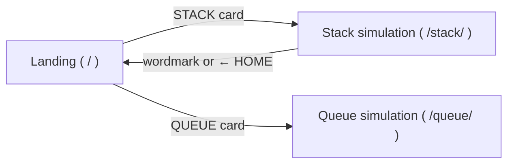
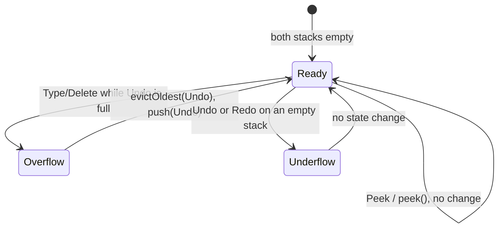

# Simulation 1: The Undo/Redo Text Editor (Stack — LIFO)

A minimalist word processor where every user action pushes the previous document state onto an **Undo Stack**, and every undo moves the current state onto a **Redo Stack**. Both stacks are drawn live next to the editor so the audience sees each push and pop as it happens.

---

## 1. Why a Stack?

"Last-In, First-Out" feels abstract until you realize that **the most recent edit must be undone first**. You cannot undo the word you typed five minutes ago without first undoing everything typed after it. That is LIFO.

Redo shows the second idea: **two stacks working together**. Whatever you undo goes onto a second stack so you can bring it back, in reverse order of undoing.

---

## 2. Learning Objectives

After the demo, students should be able to:

1. Define a stack and its core operations: `push`, `pop`, `peek`, `isEmpty`, `size`.
2. Explain why undo history is LIFO and not FIFO.
3. Trace the dual-stack (Undo + Redo) algorithm by hand for a sequence of actions.
4. Explain why a **new action clears the Redo Stack** (history branching).
5. Use **`peek()`** to inspect the top element without removing it.
6. Recognize **stack underflow** (popping an empty stack) and **stack overflow** (pushing onto a full, capped stack), and explain how the editor handles each.
7. State the time complexity of every operation used.
8. Read an array-based stack in **C** (fixed-size array, `top` index, `-1` = empty) and match each line to what the animation shows.

---

## 3. Tech Stack & Deployment

The site is a **static, client-rendered website deployed on Vercel**. There is no backend, no build step, and no framework. The browser renders everything from plain files.

| Layer | Choice | Reason |
|---|---|---|
| UI | Plain HTML + CSS | Nothing to compile. Vercel serves the files as-is. |
| Logic | Vanilla JavaScript (ES6 classes), classic `<script defer>` | Readable for a DSA audience. Classic scripts (not ES modules) also run from `file://`, so a double-click fallback works if the classroom Wi-Fi dies. |
| Data structure | Hand-written `Stack` class backed by an array | Students see the stack implemented, not hidden behind a library. |
| Hosting | Vercel static deploy (Framework preset: **Other**, no build command, output dir = repo root) | Free, global CDN, deploys on `git push`. |
| Offline | Service worker (`sw.js`) with cache-first strategy | After one visit, the site loads and runs with **no internet at all**. |
| Runtime | Any modern browser (Chrome/Edge/Firefox/Safari, desktop + mobile) | Works on the presenting laptop and students' phones. |

### 3.1 Minimal-Internet Rules

The site has to work on weak or absent connections:

- **Zero external requests.** No CDNs, Google Fonts links, icon libraries, analytics, or images hosted elsewhere. Every byte comes from our own origin.
- **Self-hosted fonts only** (see §7.5). Two latin-subset `woff2` files, both under the SIL Open Font License: **DM Sans** (variable, 36.1 KB) and **Titan One** (10.5 KB). They load with `font-display: swap` over metric-matched local fallbacks, so text shows immediately even before the fonts arrive.
- **Icons and decorations are inline SVG or pure CSS.** No image files to download.
- **Page weight budget:** ≤ 30 KB gzipped of code per page, which is what actually crosses the network (Vercel compresses responses). This includes the 6 KB C source shown in the code panel. Fonts add ≈ 47 KB, shared across the site and cached by the service worker after the first visit.
- **Service worker** precaches every file on first load. Later visits are served from cache, then updated in the background. Bump the `CACHE_VERSION` constant in `sw.js` on each deploy so users get fresh files.
- **No runtime data fetching.** All state lives in memory. Nothing is saved to a server.

### 3.2 Site Layout

One Vercel project hosts both simulations (Stack here, Queue in `QUEUE.md`):

```
/                          # repo root = Vercel output directory
├── index.html             # landing page: pick a simulation (Stack / Queue); both cards are live links
├── vercel.json            # cleanUrls + headers (see below)
├── sw.js                  # service worker: precache + offline (must sit at root for full scope)
├── assets/
│   ├── theme.css          # shared design tokens + components (buttons, cards, bubble, highlighter) — §7.5
│   ├── sim.css            # shared simulation chrome: site header, settings dropdown, tour, code panel, tabs, log, toast
│   ├── code-panel.js      # renders + syntax-highlights the C code, plays line traces (moved from stack/, now configurable)
│   ├── tour.js            # TIPS onboarding tour (§7.8), now configurable (moved from stack/)
│   ├── landing.css        # landing-page-only layout and entrance animation
│   ├── sw-register.js     # registers sw.js (shared by every page)
│   ├── favicon.svg
│   └── fonts/
│       ├── dm-sans-latin.woff2     # variable 400–800, OFL
│       └── titan-one-latin.woff2   # display font, OFL
├── stack/
│   ├── index.html         # editor, controls, two stack panels, C code panel, operation log
│   ├── style.css          # stack-only layout (desktop → phone, §7.7) + push/pop animations
│   ├── stack.js           # Stack class (the data structure — no DOM code)
│   ├── history.js         # the dual-stack undo/redo model (mirrors the C control flow, emits C traces — no DOM)
│   ├── editor.js          # DOM: input handling, rendering, animations, callouts, log, tabs (loads ../assets/code-panel.js and ../assets/tour.js)
│   └── c-source.js        # the C program shown in the code panel (single source of truth, §7.6)
├── queue/                 # Simulation 2 (see QUEUE.md)
│   ├── index.html         # lane, kitchen, controls, C code panel, operation log
│   ├── style.css          # queue-only layout + lane/car/kitchen animations
│   ├── queue.js           # Queue class (the data structure — no DOM code)
│   ├── drive-thru.js      # DriveThru model: mirrors the C control flow, emits C traces — no DOM
│   ├── app.js             # DOM: rendering, animations, kitchen timer, callouts, log, tabs, settings
│   └── c-source.js        # the C program shown in the code panel (single source of truth, QUEUE.md §7.5)
├── scripts/
│   ├── check-c.mjs        # dev-only: compiles + runs both C programs, diffs with their expected output
│   ├── expected-stack.txt # the undo/redo C demo's expected stdout (= §8 table)
│   └── expected-queue.txt # the drive-thru C demo's expected stdout (= QUEUE.md §8 table)
├── serve.json             # local preview config for `npx serve` (same routing as Vercel)
└── .vercelignore          # keeps scripts/, docs, and serve.json out of the deployment
```

- `stack.js` must contain no DOM code, so it can be shown on a slide by itself as "the data structure."
- Pages link to each other with relative URLs (`stack/index.html`, `queue/index.html`, `../index.html`), so the site also works when opened from disk.
- **Directory pages are canonical with a trailing slash** (`/stack/`, `/queue/`). Without the slash, the page's relative URLs (`style.css`, `stack.js`) would resolve against `/` and 404. Both Vercel (`trailingSlash: true`) and the service worker (offline) redirect `/stack` and `/stack/index.html` to `/stack/`, and `/queue` / `/queue/index.html` to `/queue/`.

### 3.3 `vercel.json`

```json
{
  "cleanUrls": true,
  "trailingSlash": true,
  "headers": [
    {
      "source": "/sw.js",
      "headers": [{ "key": "Cache-Control", "value": "no-cache" }]
    }
  ]
}
```

`sw.js` must never be cached by the browser, or fixes would never reach users. Other files keep Vercel's default revalidation (`max-age=0, must-revalidate` with ETags), which suits files without content hashes in their names.

### 3.4 Local Preview

- Quick look: double-click `stack/index.html`. Everything except the service worker runs.
- Real preview (service worker included): `npx serve .` (it reads `serve.json`, which matches Vercel's routing) or `vercel dev`, then open `http://localhost:3000/stack/`.
- Model and C checks: `node scripts/check-c.mjs` compiles and runs both C programs (needs `gcc`, or set `CC`; append `stack` or `queue` to check just one).

### 3.5 Site Flow & Landing Page



The landing page is the site's cover slide, in the same style as the reference's first slide (§7.5):

```
┌──────────────────────────────────────────────────────────────────────────┐
│ ▓ sticky note ▓                                     PINK  #FF87AB       │
│ ▓ "PUSH. POP. ▓           GROUP 3 PRESENTS          tiny-square pattern  │
│ ▓  REPEAT."   ▓                                                          │
│                  ██████  ██████   ███     ██████ ██ ██   ██ ██████       │
│                  DSA SIMS  ← chunky white wordmark, thick black outline, │
│                             black extrusion, letters slightly tilted     │
│        TWO DATA STRUCTURES. ▒ZERO BORING SLIDES.▒ PICK ONE ↓             │
│                              (lime highlighter swipe)                    │
│                                                                          │
│      ╔═══════════════════════╗        ╔═══════════════════════╗          │
│      ║ SIMULATION 01         ║        ║ SIMULATION 02         ║          │
│      ║  [stacked blocks svg] ║        ║  [queue line svg]     ║          │
│      ║ STACK                 ║        ║ QUEUE                 ║          │
│      ║ UNDO / REDO EDITOR    ║        ║ DRIVE-THRU & KITCHEN  ║          │
│      ║ LAST IN, FIRST OUT    ║        ║ FIRST IN, FIRST OUT   ║          │
│      ║          [ OPEN → ]   ║        ║          [ OPEN → ]   ║          │
│      ╚═══════════════════════╝▄       ╚═══════════════════════╝▄         │
│        tilted −3°                       tilted +3°                       │
│                                                                          │
│ ©2026 GROUP 3 · DSA REPORT                          ( ✓ OFFLINE READY )  │
└──────────────────────────────────────────────────────────────────────────┘
```

| Element | Spec |
|---|---|
| Background | Pink `#FF87AB` with a subtle tiny-square pattern (CSS gradients, black at 6% opacity), like the reference's patterned slides. |
| Sticky note prop | Pure-CSS pale-yellow square, rotated −8°, soft blurred shadow, text "PUSH. POP. REPEAT." Decorative (`aria-hidden`); hidden below 576px. |
| Eyebrow | `GROUP 3 PRESENTS`, body font, uppercase, centered above the wordmark. |
| Wordmark | `DSA SIMS` in Titan One. White fill, ~0.08em black outline, solid black offset extrusion. Each letter tilted between −6° and +6°, like the reference's logo. It is our own lettering, not their logo file. |
| Tagline | Uppercase body text. "ZERO BORING SLIDES." gets the lime highlighter swipe (§7.5) after the wordmark lands. |
| Simulation cards | Two cream cards (border, radius, hard shadow), tilted −3° / +3° like the reference's "We work with" cards. Each card has an eyebrow (`SIMULATION 01`), an inline-SVG illustration, an `h3` title, and a subtitle. |
| STACK card | The whole card is a link to `/stack` (`../stack/` relative). On hover/focus it straightens to 0° and lifts (`translate(-2px,-2px)`, shadow grows to `6px 6px`). Shows a lime `OPEN →` button. |
| QUEUE card | A live link to `/queue/` (`../queue/` relative), styled like the STACK card. Subtitle `DRIVE-THRU & KITCHEN`, meta `FIRST IN, FIRST OUT`, and a lime `OPEN →` button. On hover/focus it straightens to 0° and lifts like the STACK card. |
| Footer | Small uppercase `©2026 GROUP 3 · DSA REPORT`. On the right, a white pill `✓ OFFLINE READY` appears once the service worker has finished caching, so the presenter can confirm the site will survive a Wi-Fi drop. |
| Entrance | Wordmark letters pop in staggered (scale 0.6 → 1, 40 ms apart), then the highlighter swipes, then the cards rise in. All under 1 s, using `cubic-bezier(.16,1,.3,1)`. Skipped under `prefers-reduced-motion`. |
| Mobile (< 768px) | Cards stack vertically and drop the tilt, and the wordmark scales with `clamp()`. |

---

## 4. The Data Structure

### 4.1 `Stack` class (`stack.js`)

The stack is array-backed with a **fixed capacity**, mirroring the C version's `Action items[MAX_CAP]` array (§7.6). Stack overflow is real here, not simulated.

| Method | C equivalent | Behavior | Time |
|---|---|---|---|
| `constructor(capacity)` | `init(&s, capacity)` | Create an empty stack holding at most `capacity` items (3, 4, 5, or 6) | O(1) |
| `push(item)` | `bool push(Stack *s, Action a)` | If full, return `false` (**overflow**) and push nothing. Otherwise add `item` on top and return `true`. | O(1) |
| `pop()` | `bool pop(Stack *s, Action *out)` | Remove and return the top. Return `null` on empty (**underflow**). | O(1) |
| `peek()` | `const Action *peek(const Stack *s)` | Return the top **without removing it**. Return `null` on empty. | O(1) |
| `isEmpty()` | `isEmpty(s)` | `top === -1` | O(1) |
| `isFull()` | `isFull(s)` | `top === capacity - 1` | O(1) |
| `size()` | `size(s)` | `top + 1` | O(1) |
| `top` (getter) | `s->top` | Index of the top item, `-1` when empty | O(1) |
| `capacity` (getter) | `s->capacity` | Maximum size | O(1) |
| `clear()` | `clear(s)` | Remove all items (`top = -1`) | O(1) |
| `toArray()` | loop over `items[0..top]` | Copy bottom → top, used only for rendering | O(n) |

Rules:
- The internal array is private (`#items`). Outside code may only use the methods above. No indexing into the middle, because that would break the stack abstraction.
- `push`, `pop`, and `peek` never throw. Overflow and underflow are reported through return values (`false` / `null`), and the editor turns them into callouts (§7.3).

### 4.2 What gets pushed: an `Action` block

Each stack entry is one **action block**: the edit the user made, plus the document before and after it. When you undo, the *same block* physically moves from the Undo Stack to the Redo Stack. The audience can follow one block across both stacks.

```js
{
  id:     2,                                   // unique, used to animate the same block between stacks
  kind:   "type",                              // "type" | "delete" | "paste" | "cut" | "replace"
  label:  'Typed "World"',                     // text shown on the block
  before: { text: "Hello",       cursor: 5 },  // document before the action
  after:  { text: "Hello World", cursor: 11 }  // document after the action
}
```

Blocks are drawn with a prefix: `+"World"` for typing/pasting and `−"World"` for deleting/cutting.

Undo sets the document to `before`; redo sets it to `after`. Storing both snapshots means no inverse logic is needed. Memory cost is O(m) per block for m characters, which is fine for a demo; §9 compares this with real editors.

---

## 5. The Algorithm (Dual-Stack)

The document (`current`) is plain state. The two stacks hold action blocks.

### 5.1 New action (Type / Delete / paste / cut)

```
if not redoStack.isEmpty():
    redoStack.clear()                 // INVALIDATION: the old future no longer applies
if not undoStack.push(action):        // returns false → STACK OVERFLOW
    evictOldest(undoStack)            // forget the bottom (oldest) block
    undoStack.push(action)
current = action.after
```

`evictOldest` uses **only stack operations**, so the `Stack` class stays pure:

```
evictOldest(s):
    temp = new Stack()
    while not s.isEmpty(): temp.push(s.pop())   // reverse: the oldest ends up on top of temp
    temp.pop()                                  // discard the oldest
    while not temp.isEmpty(): s.push(temp.pop()) // restore the original order
```

It costs O(n). This is a talking point (§9): a pure stack can only reach its top, so real editors use a ring buffer or deque for capped history.

### 5.2 Undo (`Ctrl+Z` or the Undo button)

```
action = undoStack.pop()
if action is null: callout "Stack Underflow"; return
current = action.before
redoStack.push(action)                // same block moves across
```

### 5.3 Redo (`Ctrl+Y` / `Ctrl+Shift+Z` or the Redo button)

```
action = redoStack.pop()
if action is null: callout "Stack Underflow"; return
current = action.after
undoStack.push(action)                // can never overflow; see invariants
```

### 5.4 Peek and Clear (the PEEK and CLEAR buttons on each stack)

```
top = stack.peek()                    // null if empty
highlight top block; callout "peek() → <label>, size unchanged"

stack.clear()                         // C: clear(&undoStack) / clear(&redoStack) → top = -1
blocks sweep out top-first; the document text is NOT changed
```

Clearing Undo means the current text can no longer be undone. Clearing Redo discards what you undid. Each CLEAR button is disabled while its stack is empty. The C trace highlights the one-line `clear()` function.

### 5.5 State Machine



### 5.6 Invariants

- `undoStack.size() + redoStack.size() ≤ capacity`. Undo and redo only move blocks between the stacks, and a new action empties Redo first. So **the Redo Stack can never overflow**, and redo never triggers eviction.
- If Undo is not empty, `current` equals `undoStack.peek().after`. If Redo is not empty, `current` equals `redoStack.peek().before`.
- Undo followed by redo restores exactly the same text and cursor.
- After any new action, `redoStack.isEmpty()` is true.
- Only the top is ever touched. The single exception, `evictOldest`, is still built from `push`/`pop`.

---

## 6. Editing Controls & Action Granularity

### 6.1 Main Panel Controls

| Control | What it does | Disabled when |
|---|---|---|
| **Word input + TYPE** (or `Enter` in the input) | Appends the input to the end of the document, with a space before it if the document is not empty. One action: `+"World"`. Clears the input afterward. | Input is empty or whitespace, or the result would exceed 255 characters |
| **DELETE** | Skips trailing whitespace, then removes the last word and the whitespace before it. One action: `−"World"`. Same rules as C `deleteLastWord` (§7.6). | Document is empty or only whitespace |
| **UNDO** | §5.2 | Undo Stack is empty |
| **REDO** | §5.3 | Redo Stack is empty |
| **PEEK** / **CLEAR** (on each stack) | §5.4 | CLEAR: that stack is empty |

The Type/Delete buttons give the presenter clean, predictable blocks on the projector. The text box also accepts **free typing**, grouped as described below.

### 6.2 Free-Typing Granularity

If we pushed every keystroke, undoing "Hello" would take 5 presses and the stack would fill at once. Real editors group keystrokes, and so do we.

A **typing burst** is committed as one action when any of these happens:

| Trigger | Example |
|---|---|
| Whitespace or punctuation typed (`space`, `Enter`, `.`, `,`, `!`, `?`) | `Hello␣` → commit `+"Hello"` |
| Idle pause ≥ 1500 ms | User stops typing mid-word. The pause is long enough that slow typing doesn't split a word into two blocks (`IDLE_COMMIT_MS` in `editor.js`). |
| Action type changes | Typing → Backspace commits the typing burst first |
| Cursor moved by click or arrow key | Editing a new location |
| Any control button pressed | A pending burst is committed first, so Undo removes it |

Other free-typing actions, each one block:
- **Delete burst**: consecutive Backspace/Delete presses become `−"lo"`.
- **Paste**: `+"…"`, always its own block.
- **Cut**: `−"…"`.
- **Select + type**: one `replace` block, labeled `"old" → "new"`.

A **Granularity toggle** (`Word` / `Keystroke`) switches free typing to one block per character, which shows why grouping exists.

Native browser undo on the `<textarea>` must be disabled. Intercept `Ctrl+Z`, `Ctrl+Y`, and `Ctrl+Shift+Z` with `preventDefault()` so only our stacks drive history.

### 6.3 Max History (Capacity)

A **MAX HISTORY** selector: `3`, `4`, `5`, `6` (default). It lives in the **SETTINGS** dropdown (the round sliders button beside TIPS in the page header), together with GRANULARITY. It sets the capacity of both stacks, so **each stack holds at most 6 blocks**. There is no "unlimited" option: the C version stores the stack in a fixed array (`Action items[MAX_CAP]`, `MAX_CAP` = 6), and a fixed size is exactly why stack overflow exists.

Changing it **resets history**: both stacks are cleared and the document text is kept, with the callout "History reset: capacity is now N." This avoids having to decide which blocks to drop when shrinking. For the overflow demo, pick `3`.

---

## 7. Core Mechanics & UI

### 7.1 Visual Display

Desktop (≥ 1200px). Tablet and phone layouts are in §7.7.

```
┌─────────────────────────────────────────────────────────────────────────────────────────┐
│ [← HOME]                              DSA SIMS                          [⚙] [TIPS: ON]  │
│                            SIMULATION 01 · STACK (LIFO)                                 │
│                            UNDO / REDO TEXT EDITOR                                      │
├───────────────────────────┬──────────────────────────────┬──────────────────────────────┤
│ ╔═══════════════════════╗ │ ╔════════════╗ ╔════════════╗ │ ╔══════════════════════════╗ │
│ ║ Hello|                ║ │ ║ UNDO STACK ║ ║ REDO STACK ║ │ ║ UNDO_REDO.C [COPY][↓ .C] ║ │
│ ║  (live text box)      ║ │ ║ 1/5 [PEEK] ║ ║ 1/5 [PEEK] ║ │ ║ DATA│STACK OPS│UNDO/REDO…║ │
│ ╚═══════════════════════╝ │ ║[4] ┌ ─ ─ ┐ ║ ║[4] ┌ ─ ─ ┐ ║ │ ║  88 bool undo(void) {    ║ │
│ [word...    ] [TYPE]      │ ║[3] └ ─ ─ ┘ ║ ║[3] └ ─ ─ ┘ ║ │ ║  89     Action a;        ║ │
│ [DELETE] [UNDO] [REDO]    │ ║  …         ║ ║  …         ║ │ ║▶ 90     if (!pop(&undo…  ║ │
│                           │ ║[0] ┌─────┐ ║ ║[0] ┌─────┐ ║ │ ║  93     strcpy(doc, a.b… ║ │
│                           │ ║    │Hello│ ║ ║    │World│ ║ │ ║  94     push(&redoStack… ║ │
│ ╭───────────────────────╮ │ ║    └─────┘ ║ ║    └─────┘ ║ │ ║ ──────────────────────── ║ │
│ │ POP() TOOK +"WORLD"   │ │ ║  top = 0   ║ ║  top = 0   ║ │ ║ undo() → pop(&undoStack) ║ │
│ │ OFF THE TOP. LIFO!    │ │ ╚════════════╝ ╚════════════╝ │ ║ undoStack.top=0 redo…=0  ║ │
│ ╰──╲────────────────────╯ │  pink blocks    lime blocks  │ ╚══════════════════════════╝ │
├───────────────────────────┴──────────────────────────────┴──────────────────────────────┤
│ > OPERATION LOG  #3 UNDO  undo.pop() → +"World"  redo.push(+"World")  undo 1 · redo 1   │
└─────────────────────────────────────────────────────────────────────────────────────────┘
```

| Component | Behavior |
|---|---|
| **Main panel** | Live text box (`<textarea>`, monospace) plus the controls from §6.1. |
| **Stack visualizers** | Two **vertical containers side-by-side**, labeled **Undo Stack** and **Redo Stack**. Blocks pile up from the bottom; the **top block is drawn highest** and carries a black `TOP` tag. Slots are numbered like the C array, `[0]` at the bottom to `[capacity-1]`, and the footer reads `top = n` (`-1` when empty). Each container shows `size n / capacity` and dashed **empty slots** for unused capacity, so you can see how full it is. A full stack gets a red `FULL` stamp. |
| **PEEK / CLEAR buttons** (per stack) | §7.2 Peek; §5.4 Clear. |
| **TIPS button** | Starts the onboarding tour (§7.8). The callouts on/off switch lives in SETTINGS. |
| **Undo / Redo buttons** | Tooltip comes from `peek()`, e.g. `Undo: +"World"`. |
| **Callout bubble** | A speech bubble under the controls shows the learning callouts from §7.3. |
| **Operation log** | Newest first. Each line lists the exact stack calls, including return values (`push → false`, `pop → null`), and the sizes afterward. Overflow and underflow lines are red. |
| **C code panel** | The same algorithm in C, with the executing lines highlighted live (§7.6). |
| **Hover (mouse) or tap (touch) a block** | Shows the full `before → after` text: a tooltip on desktop, the bubble/toast on phones. Read-only. |

### 7.2 Step-by-Step Flow (Animations)

The model updates **immediately**. Animations only replay the change. If the user acts mid-animation, pending animations skip to their end state, so the UI never blocks input. Every animation lasts ≤ 400 ms (invalidation ≤ 800 ms total), uses CSS transforms only, and becomes instant under `prefers-reduced-motion`.

| Event | What the audience sees |
|---|---|
| **Push** (Type "Hello", then "World") | A new block **slides down into the Undo Stack from the top** of the container and lands on the pile. The `TOP` marker moves to it, and the size counter ticks up. |
| **Pop** (Undo) | The top block (`+"World"`) **lifts off the Undo Stack, arcs across, and drops onto the Redo Stack**, fading from pink to lime on the way. The block flies on a fixed top layer (a clone above the whole page), so it passes **in front of** both stacks' outlines instead of being clipped behind them. The real block appears in its new slot when the flight lands. The text box reverts to `Hello`, and the reverted text flashes briefly. |
| **Redo** | The reverse: the top Redo block arcs back onto the Undo Stack on the same top layer, lime to pink, and the text is re-applied. |
| **Stack Invalidation** | When a new action happens while Redo has blocks, the **Redo Stack visibly clears completely**: blocks fly out one by one, **top first** (80 ms apart), and the container flashes. A black banner with lime text reads "REDO HISTORY DISCARDED: YOU BRANCHED TO A NEW FUTURE." Only then does the new block slide into the Undo Stack. |
| **Overflow** | The new block hovers above the full Undo Stack, which **shakes** under a red `STACK OVERFLOW` stamp. The **bottom block drops out through the floor** and fades, the pile settles down one slot, and the new block lands on top. |
| **Underflow** | The empty container wobbles, and the bubble shows the underflow callout. Nothing moves. |
| **Peek** | The top block **glows and bobs** for 1.5 s while staying in place. The size counter pulses to show it did **not** change. |

### 7.3 Key Learning Callouts

Callouts appear in the speech bubble and disappear after 4 s. **SETTINGS → CALLOUTS: OFF** turns them off for fast typing. Push and Pop callouts show only the first 3 times so they don't nag. The rest show every time.

| Trigger | Callout |
|---|---|
| Push | "`push()`: new block on top! Undo Stack size is now 2." |
| Undo (pop) | "`pop()` always takes the **TOP** block: `+"World"`. Last In, First Out. It moves to the Redo Stack." |
| Redo | "Redo pops from the Redo Stack, also LIFO, so the last thing you undid comes back first." |
| Invalidation | "You typed something new after undoing, so the old redo history no longer matches your document. `redo.clear()`." |
| **Overflow** | "**Stack Overflow!** `push()` returned `false`: the stack is full (3/3). The oldest action `+"a"` is forgotten for good. That's why real editors have a history limit." |
| Underflow | "**Stack Underflow!** `pop()` on an empty stack returned `null`. Nothing to undo." |
| **Peek** | "**`peek()` → `+"World"`.** You looked at the top **without removing it**. Size is still 2. Undo uses this to show its tooltip." |
| Peek on empty | "`peek()` → `null`: the stack is empty." |
| Capacity change | "History reset: capacity is now 3." |
| Clear | "`clear(&undoStack)` set top = -1: 2 undo steps gone. The text stays, but you can no longer undo it." (Redo: "… Nothing left to redo.") |

### 7.4 Keyboard Shortcuts

| Keys | Action |
|---|---|
| `Ctrl+Z` | Undo |
| `Ctrl+Y` / `Ctrl+Shift+Z` | Redo |
| `Enter` (in word input) | Type |

### 7.5 Visual Theme: Copied from Nodeck

The whole site (landing, Stack, and later Queue) copies the **visual language** of [nodeck.online](https://www.nodeck.online/): bold neo-brutalist "sticker" UI, flat candy colors, thick black outlines, hard offset shadows, all-caps type, and playful tilts. These values were measured from its live stylesheet and DOM.

**We copy the style, not the assets.** Their logo SVG, illustrations, photos, sounds, and the commercial **BN Dime Display** font are not reused. The display font is swapped for **Titan One** (OFL), which was the closest of six free heavy display fonts compared side by side. Decorations are redrawn in CSS/SVG.

#### Tokens (`assets/theme.css`)

| Token | Value | Source | Used for |
|---|---|---|---|
| `--pink` | `#FF87AB` | Nodeck cover/problem slides | landing background, Undo Stack blocks |
| `--cream` | `#F3E6D6` | Nodeck cards, theme-color | Stack page background, landing simulation cards |
| `--lime` | `#DEF915` | Nodeck buttons, highlighter | primary buttons, highlighter, Redo Stack blocks, peek glow |
| `--black` | `#000000` | Nodeck | text, borders, shadows, TOP tag, terminal background |
| `--white` | `#FFFFFF` | Nodeck | text box, stack containers, secondary buttons, speech bubble |
| `--term-green` | `#22E34D` | Nodeck terminal slide | operation-log text |
| `--red` | `#FF5C5C` | Nodeck terminal error | red overflow/underflow log lines, stack FULL / OVERFLOW stamps, queue QUEUE OVERFLOW / NO CUTTING signs |
| `--note` | `#F2E38B` | ours (approximates their sticky-note photo) | landing sticky note |
| `--border` | `3px solid #000` | Nodeck `.btn`, cards | every button, card, container, block, input |
| `--radius` | `10px` | Nodeck `.btn`, cards | buttons, cards, containers, blocks |
| `--radius-bubble` | `1.25rem` | Nodeck speech bubble | callout bubble |
| `--shadow` | `4px 4px 0 #000` | Nodeck `.btn`, cards | resting hard shadow |
| `--shadow-hover` | `2px 2px 0 #000` | Nodeck `.btn:hover` | hovered buttons |
| `--ease-out` | `cubic-bezier(.16,1,.3,1)` | Nodeck | entrances, block moves |
| `--ease-expo` | `cubic-bezier(.19,1,.22,1)` | Nodeck | long arcs (Undo/Redo block travel) |

#### Typography

| Role | Font | Size | Notes |
|---|---|---|---|
| Display (`h1`, wordmark) | Titan One 400 | `clamp(3.5rem, 2.6rem + 4.5vw, 8rem)`, line-height .98 | uppercase |
| `h2` (page titles) | Titan One 400 | `clamp(2rem, 1.35rem + 3.25vw, 5.25rem)`, .98 | uppercase |
| `h3` (card titles) | Titan One 400 | `clamp(1.5rem, 1.3rem + 1vw, 2.5rem)`, .98 | uppercase |
| Body, eyebrows, buttons | DM Sans 400 / 700 (buttons) | `1rem` (`.875rem` < 768px), `p` line-height 1.4 | **all uppercase**, as in Nodeck |
| User text (text box, block labels, log) | `ui-monospace, Consolas, monospace` | `1.125rem` box, `.875rem` log | **never uppercased**: `Hello` vs `HELLO` is the user's data |

Fallbacks are metric-adjusted `@font-face` aliases of local Arial (`size-adjust` / `ascent-override`, the same trick Nodeck uses), so the layout doesn't jump when the webfonts swap in.

#### Components

| Component | Spec (from Nodeck) |
|---|---|
| `.btn` (primary) | Lime bg, `--border`, `--radius`, `--shadow`, DM Sans 700 uppercase, `gap .5rem`, `padding .5rem 1rem`. Hover: `translate(2px,2px)` + `--shadow-hover`. Active: `translate(4px,4px)` + no shadow. Transition `all .1s ease-out`. Disabled: `opacity .5`, no movement. |
| `.btn--white` | Same as above with white bg (Nodeck's PREV/NEXT). Used for UNDO/REDO/DELETE/PEEK; TYPE and OPEN are lime. |
| `.btn-round` | 4rem circle, lime, shadow `0 4px 0 #000`; press moves down 2px/4px. Used for the TIPS toggle. |
| `.card` | Cream bg, `--border`, `--radius`, `--shadow`, padding `2rem`. Optional tilt `--tilt: ±3deg`. |
| `.bubble` | White, `--border`, `--radius-bubble`, padding `1rem 2rem`, line-height 1.4, a 1.1rem triangular tail drawn with borders. |
| `.text-highlight` | Lime brush-stroke SVG (ours) behind inline text, revealed left → right by animating `clip-path: inset(0 calc(100% - var(--p)) 0 0)`, as Nodeck does. |
| `.stamp` | Red uppercase text in a red 3px rounded border, rotated −8°, slightly transparent: our CSS take on Nodeck's "classified" stamp. |
| `.terminal` | Black bg, `--term-green` monospace text, red error lines, `>` prompt with a blinking block cursor, like Nodeck's "site crashed" terminal slide. Used for the operation log. |
| Header wordmark | Small `DSA SIMS` wordmark centered at the top of inner pages, linking home, like Nodeck's top-center logo. |
| Focus | `:focus-visible { outline: 3px solid #000; outline-offset: 6px }` (lime outline inside the terminal). |
| Selection | `::selection { background: #000; color: #fff }` |

#### Stack Page Mapping

- **Page:** cream background. Header has the wordmark, an eyebrow `SIMULATION 01 · STACK (LIFO)`, and an `h2` `UNDO / REDO TEXT EDITOR`.
- **Text box:** white, `--border`, `--radius`, `--shadow`, monospace, normal case.
- **Stack containers:** white cards with a black uppercase header strip (`UNDO STACK` / `REDO STACK`), size counter, and PEEK button.
- **Blocks:** Undo blocks are **pink**, Redo blocks are **lime**, so a block visibly changes color as it moves across. Each has `--border`, `--radius`, `--shadow`, and alternating ±1.5° tilts like a pile of stickers. The **TOP block sits straight (0°)** with a black `TOP` tag.
- **Empty slots:** dashed 3px borders at 25% black.
- **Peek glow:** lime 6px outline plus a bob.
- **Log:** the `.terminal` component.

Rules:
- **Cute, not cluttered.** The decorations are the sticky note on the landing page and the tilts. No mascot, no sound effects (Nodeck has sound; we skip it to stay small and classroom-friendly).
- **Buttons are uppercase text with small inline-SVG icons** (3px stroke, like Nodeck's chevrons), not emoji.
- **Responsive:** full breakpoint and phone rules are in §7.7.
- **Accessible:** contrast is black on pink/cream/lime/white (all ≥ 9:1). All buttons have text labels, focus rings are visible, and the callout bubble and stack containers use `aria-live="polite"` so screen readers announce push, pop, peek, overflow, and underflow.

### 7.6 C Code Panel

The same algorithm, written in **C**, is shown next to the stacks, and **the lines that run are highlighted live** with each click. Students see the animation, the state, and the C source move together.

**Why C:** an array stack in C has a fixed size (`Action items[MAX_CAP]`) and an explicit `top` index. Overflow, underflow, and `top = -1` are visible in the code instead of hidden behind a growable array.

#### The program

- **Single source:** `stack/c-source.js` sets `C_SOURCE` to a `String.raw` template. The C contains no backticks or `${`, so it embeds verbatim. It is not fetched, so it works offline and from `file://`.
- Standard C99, standard headers only, 202 lines in five sections: Data · Stack ops · Undo/Redo · Helpers · `main()` demo.
- **Verified while writing this spec:**
  - It compiles with **zero warnings** under `gcc -std=c99 -Wall -Wextra -Wpedantic -Werror`.
  - `main()` replays the §8 script, and its printed stacks match the §8 table for all 14 steps.
  - A separate edge-case harness passed: trailing whitespace, whitespace-only document, one-word document, the 255-character limit, label truncation, and undo/redo/peek on empty stacks.
- `scripts/check-c.mjs` (dev-only, not deployed) repeats that check for both programs. It writes each `C_SOURCE` to a temp file, compiles it with the flags above, runs it, and diffs stdout against `scripts/expected-stack.txt` for `undo_redo` and `scripts/expected-queue.txt` for `drive_thru`. Run it after any change to either C.

<details>
<summary>Full <code>undo_redo.c</code> (exactly what the panel shows)</summary>

```c
/* undo_redo.c - Undo/Redo text editor using two array-based stacks (LIFO) */
#include <stdio.h>
#include <stdbool.h>
#include <ctype.h>
#include <string.h>

#define MAX_TEXT  256   /* document buffer size (255 chars + '\0')  */
#define MAX_LABEL  32   /* block label, e.g. +"World"                */
#define MAX_CAP     6   /* largest MAX HISTORY option                */

/* ---------- 1. The data ---------- */
typedef struct {
    char label[MAX_LABEL];   /* what the user did             */
    char before[MAX_TEXT];   /* document before the action    */
    char after[MAX_TEXT];    /* document after the action     */
} Action;

typedef struct {
    Action items[MAX_CAP];
    int top;                 /* index of the top item; -1 = empty */
    int capacity;            /* chosen MAX HISTORY: 3, 4, 5, 6    */
} Stack;

/* ---------- 2. Stack operations (all O(1)) ---------- */
void init(Stack *s, int capacity) {
    s->top = -1;
    s->capacity = capacity;
}

bool isEmpty(const Stack *s) { return s->top == -1; }
bool isFull(const Stack *s)  { return s->top == s->capacity - 1; }
int  size(const Stack *s)    { return s->top + 1; }
void clear(Stack *s)         { s->top = -1; }

bool push(Stack *s, Action a) {
    if (isFull(s)) {
        return false;                 /* STACK OVERFLOW  */
    }
    s->top++;
    s->items[s->top] = a;
    return true;
}

bool pop(Stack *s, Action *out) {
    if (isEmpty(s)) {
        return false;                 /* STACK UNDERFLOW */
    }
    *out = s->items[s->top];
    s->top--;
    return true;
}

const Action *peek(const Stack *s) {
    if (isEmpty(s)) {
        return NULL;
    }
    return &s->items[s->top];         /* look, don't remove */
}

/* ---------- 3. The editor: two stacks ---------- */
Stack undoStack, redoStack;
char doc[MAX_TEXT] = "";

/* Drop the oldest (bottom) action using only push/pop: O(n) */
void evictOldest(Stack *s) {
    Stack temp;
    Action a;
    init(&temp, s->capacity);
    while (pop(s, &a)) {
        push(&temp, a);               /* reverse: oldest ends on top */
    }
    pop(&temp, &a);                   /* discard the oldest          */
    while (pop(&temp, &a)) {
        push(s, a);                   /* restore the original order  */
    }
}

void doAction(Action a) {
    if (!isEmpty(&redoStack)) {
        clear(&redoStack);            /* INVALIDATION: new branch    */
    }
    if (!push(&undoStack, a)) {       /* OVERFLOW: stack is full     */
        evictOldest(&undoStack);
        push(&undoStack, a);
    }
    strcpy(doc, a.after);
}

bool undo(void) {
    Action a;
    if (!pop(&undoStack, &a)) {
        return false;                 /* nothing to undo */
    }
    strcpy(doc, a.before);
    push(&redoStack, a);              /* same block moves across */
    return true;
}

bool redo(void) {
    Action a;
    if (!pop(&redoStack, &a)) {
        return false;                 /* nothing to redo */
    }
    strcpy(doc, a.after);
    push(&undoStack, a);
    return true;
}

/* ---------- 4. Helpers for the TYPE / DELETE buttons ---------- */
Action makeAction(char sign, const char *word, const char *after) {
    Action a;
    snprintf(a.label, MAX_LABEL, "%c\"%.27s\"", sign, word);
    strcpy(a.before, doc);
    strcpy(a.after, after);
    return a;
}

bool typeWord(const char *word) {
    char after[MAX_TEXT];
    size_t need = strlen(doc) + (doc[0] ? 1 : 0) + strlen(word);
    if (need >= MAX_TEXT) {
        return false;                 /* document full (255 chars) */
    }
    strcpy(after, doc);
    if (doc[0] != '\0') {
        strcat(after, " ");
    }
    strcat(after, word);
    doAction(makeAction('+', word, after));
    return true;
}

bool deleteLastWord(void) {
    char word[MAX_TEXT], after[MAX_TEXT];
    size_t end = strlen(doc), start, keep;
    while (end > 0 && isspace((unsigned char)doc[end - 1])) {
        end--;                        /* skip trailing spaces         */
    }
    if (end == 0) {
        return false;                 /* nothing to delete            */
    }
    start = end;
    while (start > 0 && !isspace((unsigned char)doc[start - 1])) {
        start--;                      /* walk back to the word start  */
    }
    keep = start;
    while (keep > 0 && isspace((unsigned char)doc[keep - 1])) {
        keep--;                       /* drop the space before it     */
    }
    memcpy(word, doc + start, end - start);
    word[end - start] = '\0';
    memcpy(after, doc, keep);
    after[keep] = '\0';
    doAction(makeAction('-', word, after));
    return true;
}

/* ---------- 5. Demo: the classroom script ---------- */
void printStack(const char *name, const Stack *s) {
    int i;
    printf("  %-5s [", name);
    for (i = 0; i <= s->top; i++) {
        printf("%s%s", i ? ", " : "", s->items[i].label);
    }
    printf("]  size %d/%d\n", size(s), s->capacity);
}

void show(const char *step) {
    printf("%s\n  doc   \"%s\"\n", step, doc);
    printStack("undo", &undoStack);
    printStack("redo", &redoStack);
}

int main(void) {
    const Action *top;
    init(&undoStack, 6);
    init(&redoStack, 6);

    show("1  open");
    typeWord("Hello");   show("2  type Hello");
    typeWord("World");   show("3  type World");
    top = peek(&undoStack);
    printf("4  peek -> %s (size still %d)\n", top ? top->label : "NULL", size(&undoStack));
    undo();              show("5  undo");
    redo();              show("6  redo");
    deleteLastWord();    show("7  delete");
    undo();              show("8  undo");
    undo();              show("9  undo");
    typeWord("There");   show("10 type There (redo cleared)");
    undo(); undo();
    printf("11 third undo returns %s (UNDERFLOW)\n", undo() ? "true" : "false");
    show("11 after undo x3");

    init(&undoStack, 3);
    init(&redoStack, 3);  show("12 max history = 3");
    typeWord("a"); typeWord("b"); typeWord("c"); typeWord("d");
    show("13 type a b c d (OVERFLOW evicts +a)");
    undo(); undo(); undo();
    printf("14 fourth undo returns %s\n", undo() ? "true" : "false");
    show("14 after undo x3");
    return 0;
}
```

</details>

#### JS ↔ C Parity

The trace is only honest if the JS follows the same control flow as the C:

| JS (`stack.js` / `editor.js`) | C (`undo_redo.c`) | Note |
|---|---|---|
| `Stack` methods | same names (§4.1 table) | `pop`/`peek` return `null` where C returns `false` / `NULL` |
| `evictOldest`, `doAction`, `undo`, `redo` | same names | identical branches and loops |
| `typeWord`, `deleteLastWord` | same names | identical word and whitespace rules |
| Action `label`, `before`, `after` | `Action` struct fields | `id`, `kind`, and cursors are UI-only and not in C |
| document ≤ 255 characters | `char doc[MAX_TEXT]` (256 including `'\0'`) | UI enforces the same limit |
| label word ≤ 27 characters | `%.27s` in `makeAction` | UI truncates identically |

#### Panel UI

| Part | Spec |
|---|---|
| Header | `UNDO_REDO.C` title plus `COPY` and `DOWNLOAD .C` buttons (`.btn--white`). Download builds a Blob from `C_SOURCE`, so it works offline. |
| Section tabs | `DATA · STACK OPS · UNDO/REDO · HELPERS · MAIN`. Each jump-scrolls to that section. |
| Code body | Black `.terminal` surface, monospace 13px (12px on phones), line numbers, **no wrapping**: long lines scroll sideways inside the panel only. |
| Live highlight | Executing line: lime background, black text, `▶` in the gutter. Lines already run in this trace keep a 3px lime left border that fades 1.5 s after the trace ends. Loop lines show a `×n` badge. |
| Call trace | One-line breadcrumb under the code, e.g. `doAction(a) → push(&undoStack, a) → false → evictOldest(&undoStack) → push(&undoStack, a) → true`. |
| Watch strip | Live C variables: `undoStack.top = 1 · redoStack.top = -1 · capacity = 5 · doc = "Hello"`. They change in step with the highlighted line. |
| FOLLOW toggle | On (default): auto-scroll so the executing line is centered. Off: the panel stays where the user scrolled. |

Syntax colors, all on black and all at WCAG AA or better. A ~40-line regex tokenizer in `assets/code-panel.js` does the highlighting; no library.

| Token | Color |
|---|---|
| Keywords and types (`typedef struct bool int char void const size_t return if while`) | pink `#FF87AB` |
| Function names | lime `#DEF915` |
| Strings and chars | cream `#F3E6D6` |
| Numbers, `NULL`, `true`, `false` | white |
| Preprocessor (`#include`, `#define`) | green `#22E34D` |
| Comments | gray `#9A9A9A` (7.5:1) |

#### Trace Mechanism

- **Anchors** are `(function, snippet)` pairs, e.g. `["push", "s->top++;"]`. At load, each anchor resolves to a line number by searching **only inside that function's body** (from its header to the next `}` in column 0), so repeated lines like `return true;` stay unambiguous.
- Each anchor must match exactly once. If one doesn't, the panel logs `console.error` and shows `TRACE UNAVAILABLE` rather than highlighting the wrong lines.
- `editor.js` emits anchors for the **branch actually taken**:

| UI event | C lines highlighted, in order |
|---|---|
| TYPE / DELETE | the helper's `doAction(makeAction(...))` line → `doAction`: `if (!isEmpty(&redoStack))` → `if (!push(&undoStack, a))` → `push`: `if (isFull(s))` → `s->top++;` → `s->items[s->top] = a;` → `return true;` → `doAction`: `strcpy(doc, a.after);` |
| …while Redo has blocks | adds `clear(&redoStack);` after the first check (**invalidation**) |
| …while Undo is full | `push`: `return false;` → `evictOldest(&undoStack);` → the `evictOldest` loops (with `×n` badges) → `push(&undoStack, a);` (**overflow**) |
| Free typing / paste / cut commit | starts at `doAction` (no helper) |
| UNDO | `undo`: `if (!pop(&undoStack, &a))` → `pop`: `if (isEmpty(s))` → `*out = s->items[s->top];` → `s->top--;` → `return true;` → `undo`: `strcpy(doc, a.before);` → `push(&redoStack, a);` → `push` lines → `return true;` |
| UNDO on empty | `pop`: `return false;` → `undo`: `return false;` (**underflow**) |
| REDO | mirror of UNDO inside `redo` |
| PEEK | `peek`: `if (isEmpty(s))` → `return &s->items[s->top];` or `return NULL;` |
| MAX HISTORY change | `init` lines, for `undoStack` then `redoStack` |

- **Playback:** 90 ms per line, capped at 1.2 s per trace. Long loops compress into one highlighted pass with `×n`. A new action jumps the current trace to its end. Under `prefers-reduced-motion`, all lines of the trace highlight at once.

### 7.7 Responsive Layout (Phone-Friendly)

| Width | Layout |
|---|---|
| ≥ 1200px (laptop, projector) | Three columns: editor + controls + bubble · the two stacks · C code panel (sticky, height = viewport − header). Log full width below. |
| 768–1199px (tablet, small laptop) | Editor + controls full width. Below: stacks (left) and C code (right), 50/50. Log below. |
| < 768px (phone) | Single column with a sticky bottom action bar and `C CODE | LOG` tabs, as below. |

Phone (375px):

```
┌─────────────────────────────┐
│ [←]    DSA SIMS  [⚙] [TIPS] │  [⚙] opens the SETTINGS dropdown
│   SIMULATION 01 · STACK     │
│   UNDO / REDO EDITOR        │
│ ╔═════════════════════════╗ │
│ ║ Hello|                  ║ │  text box, 16px font
│ ╚═════════════════════════╝ │
│ ╔═══════════╗ ╔═══════════╗ │
│ ║UNDO   1/5 ║ ║REDO   1/5 ║ │  still side by side
│ ║  [PEEK]   ║ ║  [PEEK]   ║ │
│ ║[4]┌ ─ ─ ┐ ║ ║[4]┌ ─ ─ ┐ ║ │
│ ║ …         ║ ║ …         ║ │
│ ║[0]│Hello│ ║ ║[0]│World│ ║ │
│ ╚═══════════╝ ╚═══════════╝ │
│ [ C CODE ] [ LOG ]          │  tabs
│ ╔═════════════════════════╗ │
│ ║▶90  if (!pop(&undoSt… → ║ │  scrolls sideways inside
│ ║ 93  strcpy(doc, a.bef…  ║ │
│ ║ undoStack.top = 0 …     ║ │
│ ╚═════════════════════════╝ │
│ ╭─────────────────────────╮ │  callout toast
│ │ POP() TOOK +"WORLD"...  │ │
│ ╰─────────────────────────╯ │
├─────────────────────────────┤  sticky action bar
│ [word...          ] [TYPE]  │
│ [DELETE] [ UNDO ] [ REDO ]  │
└─────────────────────────────┘
```

Phone rules:
- **Tested widths:** 320, 360, 375, 390, 414px, plus 740×360 landscape. **No horizontal page scrolling** at any of them; only the code body scrolls sideways.
- **Viewport meta:** `width=device-width, initial-scale=1, viewport-fit=cover, interactive-widget=resizes-content`, so the on-screen keyboard resizes the layout instead of covering the action bar.
- **Sticky action bar** at the bottom:
  - Row 1 is the word input + TYPE; row 2 is DELETE · UNDO · REDO at equal widths.
  - Bottom padding includes `env(safe-area-inset-bottom)`, and the page reserves the bar's height so nothing hides under it.
  - When the viewport is shorter than 500px (landscape), the bar stops being sticky.
- **Touch:** targets are at least 44×44px. Inputs and the textarea use a font size of at least 16px, which stops iOS from zooming on focus.
- **SETTINGS** (granularity, max history, callouts on/off) sit in a dropdown opened by the round sliders button **beside TIPS in the header**, at every screen size. The dropdown closes on an outside tap or Escape. On phones it spans the screen width under the header.
- **Header centering:** the eyebrow and title span the full header width, so they are centered on the page. On phones the top row is `auto 1fr auto`, so the wordmark sits centered in the space **between** the HOME button and the SETTINGS/TIPS buttons, with equal gaps on both sides. On desktop the row is a symmetric `1fr auto 1fr`.
- **Stacks stay side by side,** because the arc animation needs it. Each is at least 150px wide at 320px. Blocks are 40px tall (at most 6 per stack, so no compact mode is needed); labels ellipsize.
- **`C CODE | LOG` tabs** sit below the stacks, with C CODE selected by default. The code panel is 50svh tall with a 12px font and FOLLOW on, and line numbers stay pinned while scrolling sideways. Tabs never switch on their own.
- **The callout bubble becomes a toast** pinned just above the action bar (max 2 lines, tap to dismiss). Tapping a block shows its details there, since touch has no hover.
- **Motion:** tilts are removed and animations kept (with shorter arcs); `prefers-reduced-motion` is respected.
- **Landing page:** cards stack vertically and drop the tilt (§3.5).

### 7.8 Onboarding Tour (TIPS)

**TIPS** opens a short spotlight tour. It also runs once automatically on the first visit (remembered in `localStorage`). Each step dims the page, rings one control in lime, and shows one line:

| # | Control | Text |
|---|---|---|
| 1 | Text box | Type freely. Each finished word is pushed onto the Undo Stack as one block. |
| 2 | Word + TYPE | Enter a word, press TYPE: one action, one push(). |
| 3 | DELETE | Removes the last word. Deleting is an action too, so it is pushed. |
| 4 | UNDO | pop() the top Undo block and push it onto Redo. Last in, first out. |
| 5 | REDO | pop() the top Redo block and push it back onto Undo. |
| 6 | Undo Stack | Your history. The TOP block is the next one undone. Max 6 blocks. |
| 7 | Redo Stack | What you undid. Any new action clears it. |
| 8 | PEEK | peek(): see the top block without removing it. |
| 9 | CLEAR | clear(): empty this stack at once (top = -1). Your text stays. |
| 10 | SETTINGS | Word or keystroke grouping, max history (3–6), callouts on/off. |
| 11 | C code | The same algorithm in C. The running line lights up on every click. |
| 12 | Log (LOG tab on phones) | Every stack call with its return value, newest first. |
| 13 | TIPS | Replay this tour anytime. |

- **Controls:** SKIP · BACK · NEXT/DONE. Arrow keys step through the tour, Escape closes it, and Tab stays inside the card. Focus returns to TIPS when the tour closes.
- **Placement:** the card goes below the target, else above it, else beside it (tall targets such as the code panel). The page scrolls only as much as needed, so the card never covers the control it explains (verified from 1366×900 down to 320×640).
- Steps whose control is hidden at the current width are skipped.

---

## 8. Demo Script (for the report)

Run these steps live, using the Type/Delete controls. Notation: `+"x"` = typed block, `−"x"` = deleted block, stacks listed **bottom → top**. During every step the C panel highlights the lines that run. The C program's own `main()` replays this same script, and its printed output matches this table.

| # | Presenter does | Document | Undo Stack | Redo Stack | Concept shown |
|---|---|---|---|---|---|
| 1 | Open page | `""` | *(empty)* | *(empty)* | Empty stacks; Undo/Redo/Delete disabled |
| 2 | Type `Hello` | `Hello` | `+Hello` | — | **Push**: block slides down from the top |
| 3 | Type `World` | `Hello World` | `+Hello`, `+World` | — | Stack grows; TOP moves up |
| 4 | PEEK on Undo | `Hello World` | `+Hello`, `+World` | — | **peek()**: top glows, size stays 2 |
| 5 | Undo | `Hello` | `+Hello` | `+World` | **Pop**: `World` moves across; LIFO |
| 6 | Redo | `Hello World` | `+Hello`, `+World` | *(empty)* | Same block moves back |
| 7 | Delete | `Hello` | `+Hello`, `+World`, `−World` | — | Delete is an action too |
| 8 | Undo | `Hello World` | `+Hello`, `+World` | `−World` | Undoing a delete restores text |
| 9 | Undo | `Hello` | `+Hello` | `−World`, `+World` | Redo Stack grows as Undo shrinks |
| 10 | Type `There` | `Hello There` | `+Hello`, `+There` | *(cleared, animated)* | **Stack Invalidation**: branching discards redo history |
| 11 | Undo, Undo, then Undo again | `""` | *(empty)* | `+There`, `+Hello` | **Underflow** on the 3rd undo |
| 12 | Set Max history = 3 | `""` | *(empty)* | *(empty)* | History reset |
| 13 | Type `a`, `b`, `c`, then `d` | `a b c d` | `+b`, `+c`, `+d` | — | **Stack Overflow**: push fails, `+a` drops out the bottom |
| 14 | Undo ×3, then Undo again | `a` | *(empty)* | `+d`, `+c`, `+b` | `a` can no longer be undone: the cost of capped history |

---

## 9. Complexity & Discussion Points

| Operation | Time | Space |
|---|---|---|
| New action | O(1) push + O(1) redo clear | +1 block (2 snapshots, O(m), m = doc length) |
| New action on a full stack | O(n) eviction, n ≤ capacity | no growth |
| Undo / Redo | O(1) | O(1) extra |
| Peek | O(1) | O(1) |
| Render stacks | O(n) | display only, not part of the algorithm |

Talking points:
- **Why not a queue?** A queue would undo your *oldest* edit first, which is useless.
- **Why does a new action clear Redo?** After undoing, you are back in the past. A new edit starts a different future, so the old redo blocks no longer apply to the document. (Some apps keep an undo *tree*, which is a different data structure.)
- **Peek vs. pop.** The Undo button tooltip needs to know what *would* be undone without undoing it. That is exactly `peek()`.
- **Overflow in the real world.** Fixed-size stacks overflow. The famous example is the function call stack under deep recursion ("stack overflow"). Editors avoid it by capping history and forgetting the oldest edits.
- **Why is eviction O(n)?** A stack can only reach its top, so removing the bottom means unloading everything. Real editors use a ring buffer or deque, which can drop the oldest item in O(1) and still pop the newest like a stack.
- **Snapshots vs. commands.** Each block stores the whole document twice, O(m). Real editors (VS Code, Word) store only the change, e.g. `{insert "World" at 6}`, which costs O(k) for k changed characters. The stack logic is identical; only the payload differs.
- **Real-world stacks:** browser back/forward (also dual-stack), the function call stack, bracket matching, expression evaluation.

---

## 10. Edge Cases

| Case | Expected behavior |
|---|---|
| Undo with empty Undo Stack | No state change; button disabled; Underflow callout and red log line |
| Redo with empty Redo Stack | Same as above, for Redo |
| Peek on an empty stack | Returns `null`; "empty stack" callout; nothing highlighted |
| Type with empty or whitespace input | Ignored; the input shakes; nothing pushed |
| Type with several words (`big world`) | One block: `+"big world"` |
| Delete when the document ends in spaces/newlines | Skips the trailing whitespace and removes the last word plus the whitespace before it, as one block (same as C `deleteLastWord`) |
| Delete on an empty document | Button disabled; nothing pushed |
| Undo mid-typing (burst not yet committed) | Commit the burst first, then undo it. The text being typed disappears. |
| Action that doesn't change the text (Backspace at position 0, empty paste) | No push. No-op actions must not pollute the stack. |
| New action while Redo is empty | No invalidation animation or callout, just the push |
| New action while Undo is full **and** Redo has blocks | Can't happen: undo + redo ≤ capacity, so if Redo has blocks, Undo has room. After `redo.clear()` the push succeeds. |
| Capacity changed | Both stacks reset; text kept; callout shown |
| Action during an animation | Pending animations skip to their end state; the new action animates normally |
| Long word in a block | The label stores at most 27 characters of the word (same as C `%.27s`). The block display ellipsizes further if needed, and the full `before → after` text shows on hover/tap. |
| Cursor restore | After undo/redo, the caret goes to `before.cursor` / `after.cursor` |
| Document would exceed 255 characters | TYPE refuses: the input shakes and the callout says "Document full: 255 characters, the size of `char doc[256]` in C." The textarea has `maxlength="255"`. |
| Whitespace-only document | DELETE disabled (C `deleteLastWord` returns `false`) |
| A trace anchor fails to resolve | Code panel shows `TRACE UNAVAILABLE` and logs `console.error`; the rest of the simulation keeps working |

---

## 11. Acceptance Checklist

- [ ] `stack.js` implements `push` (returns `false` when full), `pop`, `peek`, `isEmpty`, `isFull`, `size`, `top`, `capacity`, `clear`, `toArray` with a private array and no DOM code.
- [ ] Main panel has a live text box plus Type, Delete, Undo, and Redo controls, each disabled per §6.1.
- [ ] Every edit path (Type, Delete, free typing, paste, cut) pushes exactly one block per committed action.
- [ ] Undo/Redo follow §5 exactly. The same block moves between stacks, and undo→redo restores identical text and cursor.
- [ ] Native textarea undo is intercepted; only the simulation's stacks drive history.
- [ ] Two vertical stack containers sit side by side, labeled Undo Stack and Redo Stack, with a TOP marker, `size / capacity`, and empty slots.
- [ ] Push slides a block down from the top; Undo/Redo arc the block across; invalidation clears Redo top-first with a banner (§7.2).
- [ ] With Max history = 3, a 4th action shows the overflow animation and callout, and evicts the bottom block via `evictOldest`.
- [ ] Peek highlights the top block without changing either stack; it works (returns `null`) on empty stacks.
- [ ] Every callout in §7.3 fires on its trigger; SETTINGS → CALLOUTS: OFF disables them.
- [ ] CLEAR empties only its own stack, leaves the text unchanged, highlights the C `clear()` line, and is disabled while that stack is empty.
- [ ] TIPS tour (§7.8) auto-runs once, replays from TIPS, and never covers the control it explains at 320–1366px widths.
- [ ] The operation log shows the exact stack calls and return values for every action.
- [ ] Granularity toggle switches free typing between word and keystroke commits.
- [ ] The §8 demo script plays out exactly as tabulated.
- [ ] Works with no internet: after the first visit, turn Wi-Fi off, reload, and the full simulation still works.
- [ ] Network tab shows **zero** requests to other origins; each page's code ≤ 30 KB gzipped; fonts are the two self-hosted `woff2` files only.
- [ ] Landing page matches §3.5: the STACK card opens `/stack`, the QUEUE card opens `/queue/`, and `OFFLINE READY` appears after caching.
- [ ] Visual theme matches §7.5 tokens: 3px black borders, 10px radius, `4px 4px 0 #000` shadows, button press offsets, uppercase UI type with mixed-case user text.
- [ ] Deployed on Vercel; `/stack` (clean URL) loads; `sw.js` is served with `Cache-Control: no-cache`.
- [ ] C panel shows `C_SOURCE` with line numbers and syntax colors; COPY and DOWNLOAD .C work offline.
- [ ] Every UI event in the §7.6 trace table highlights exactly the C lines of the branch taken, including overflow, invalidation, underflow, and peek-on-empty. The watch strip matches the JS state after each trace.
- [ ] `node scripts/check-c.mjs` passes: zero warnings under `-std=c99 -Wall -Wextra -Wpedantic -Werror`, and output identical to `scripts/expected-stack.txt` and `scripts/expected-queue.txt`.
- [ ] Responsive per §7.7: correct layouts at ≥ 1200px, 768–1199px, and < 768px. On phones: no horizontal page scroll at 320–414px, the sticky action bar stays reachable with the keyboard open, touch targets ≥ 44px, and the `C CODE | LOG` tabs work.
- [ ] Reduced-motion setting disables animations and trace playback (lines highlight instantly).

---

## 12. Stretch Goals (only if time allows)

- **Step-through mode**: each Undo/Redo pauses between `pop` and `push`, with a "Next ▶" button, so the audience sees both halves.
- **Command-pattern mode**: switch the block payload from snapshots to diffs and show the memory difference.
- **Ring-buffer mode**: replace `evictOldest` with a deque to show O(1) eviction next to the O(n) stack-only version.
